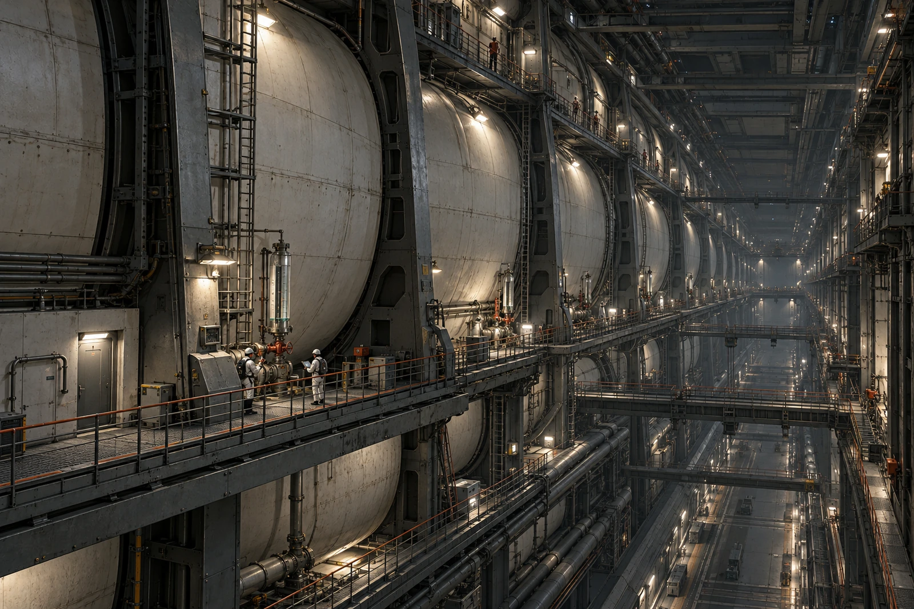

# 主储水廊道 · 检修平台移交卡

验收章只对应第六格。压在整列栏上的第一次印章划作无效，另盖在第六格复核栏；印泥已干，不刮纸。

储水设施由分格罐体和独立隔断组成，检修平台沿肋骨与阀组逐层延伸。总览从上层工作点拍下，近端人员门、采样位、平台连接与远处成列罐体提供尺度。禁止把维护窗扩大成一整面承压玻璃墙，再用漂亮水色代替结构。

第六格本班完成接口外观复查与规定取样；第四、第五格没有因位于同一张照片而获得同样结论。运行值班仍按原隔断状态调配，不得以移交卡上的“平台可用”改变水质或罐体合格状态。

## 工具与管线之间

工具领用六件，平台上清出五件，缺一只小夹。检查到下层线槽找回前，平台移交暂停。记录没有填“已落入水中”，因为罐体全程封闭，作业面与水体不直接相通。

监测屏上一条短时数据空档附原日志，值班员提出用前后值线性补齐，便于打印；数据岗只允许在展示曲线上明确标识估算段，原始记录保留缺测。不让一条连续线替人完成一次没有发生的测量。

复查结束后，原来压在整列栏的废印仍能看见。接班人手指先停在那里，再翻到背面的更正说明，才签第六格收件。其余格子留给各自实际的检修班，不在本页凑齐。
