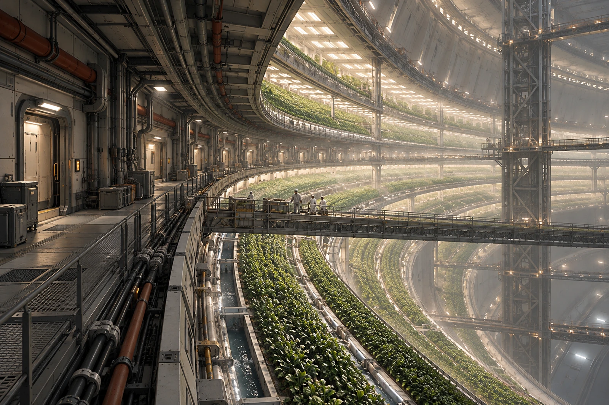

# 农业环 · 第七收获桥补光时段借还簿

收获篮标签不能抵照明工时。篮里有菜，不能据此推定借来的补光时段已经全部归还。

第七桥一段栏杆更新，收获班改走上层侧桥。作物行、水路、管线与维护网共同沿居住环内壁延伸，外场总览把近处工作门、转弯桥与远端梯田都留下。种植区不是一张没有舱壁的地球田野照片。

本班借用邻区补光两个短窗口，实际只使用第一个。第二个未用，提前交回调度，不能按预约计入已用电量。植物的照明周期调整仍归生保岗位，本簿只有借还事实，不替营养与生长条件签字。

## 篮子清点与人行分开

| 收获篮去向 | 只 |
|---|---:|
| 本班出篮 | 30 |
| 已回空篮 | 27 |
| 随样品送检 | 3 |

送检联注明编号，不写作遗失。居民试图沿关闭段搬一只空篮，值班员引去侧桥：关闭针对通行状态，不因负载轻就失效。

一盏补光灯在全景里显成紫色，现场查为影像白平衡偏差。原数据留存，展示版校正；不把它借题改成全环霓虹色的“生物工程氛围”。作物颜色与相应灯具状态按本班观察说明，不替未测波段作保证。

借用人签在领灯栏，实际没有领走灯具；更正为借时段，原名划线保留。邻区人员提醒“别把太阳拿走了”，记录员照原话附在备注，未改作正式设备名称。

桥仍闭一段，侧桥照常通行。第二个窗口已还，三只篮子等检验台实际交回。
