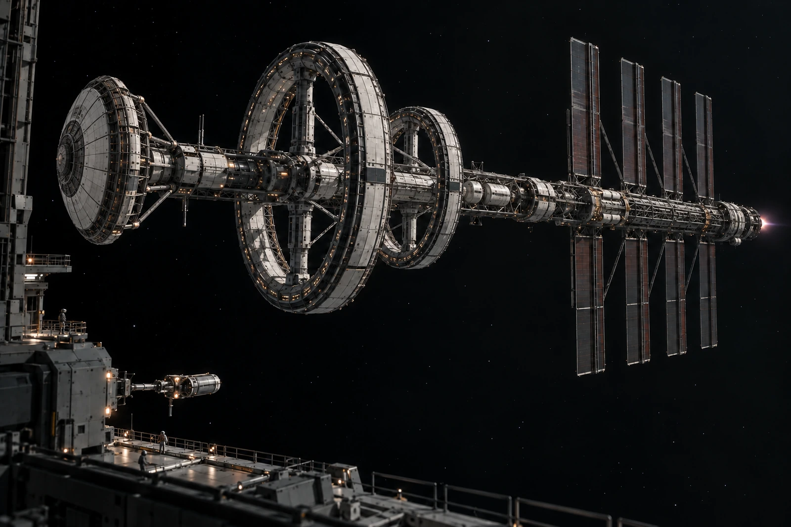

# 制动航段 · 观测工位替换令

旧观察窗预约票保留，不退换成舱外通行证。对外限制扇区仍由航行与推进值班链确定，文化观测排程无权将其移到画面之外。

本班原拟在后侧近场拍摄推进段状态，复核发现原机位进入受限方向，改用安全位置的远距观测。重新安排只改变观察工位，不改变制动程序，也不证明当前推力与航迹已经由摄影队验收。

总览须能分辨防冲盾、长轴、不等半径双环、热排构件与后部推进位置。画面里不加一个触手可及的目的地行星；尚在航段，不能借长焦布景把在途改成抵达。尾部光亮依实际记录呈现，不能为使照片“像在赶路”而涂满一束蓝火。

## 预约票背面

本次二十九人申请观看，其中十八人接受替换、七人改期、四人撤回。四份撤回保留原申请号，不删除其曾经提出申请的事实。没有把不接受替换者统一登记成心理异常。

操作岗只交付许可范围与能够提供的数据，公众画面另按可解释范围整理。某段仪表未开放，不从光亮大小倒推功率补图；尚未收到的图像不以艺术想象填在留证页上。

其中一张票被反复折在同一条线上，折断了一角。售票窗口称可换平整纸，持有人要原票。档案处只取扫描副本，实物归还。票上仍写原观察窗号，并加盖改期标记，没有假装原窗口从未被预约。

替换令至本班结束有效。下一窗口能否开放，等相应值班岗签发，不在今天的名单尾部预填。
