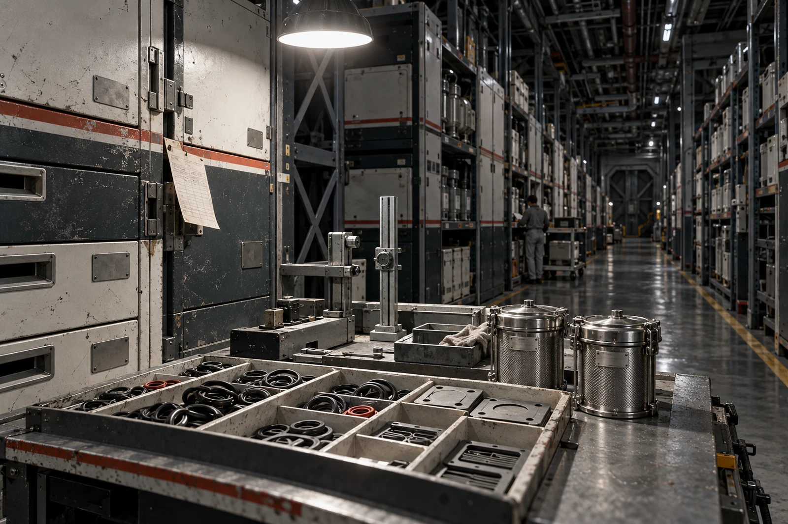

# ARK-01材料储备舱 · 三季结转联

账期2332年7月1日至9月30日。物料为H系列水培支路密封片，计数单位“片”；回收料另用质量单位。别把两栏相加。

## 储柜上两个旧凹坑

柜门下角的凹坑夹住过一张领料条。本季第一张领料条又滑进缝里，日期露在外面，签名折在里面。管理员拆铰链取出，原条无缺页，销账时间比领料晚两日，原始时刻照记。没有凭领料人记忆重开一张。

## 片数结转

| 科目 | 片 |
|---|---:|
| 季初合格库存 | 360 |
| 本季制造并通过检验 | 84 |
| 领用安装 | 96 |
| 检查后改列隔离 | 12 |
| 季末合格库存 | 336 |

360+84−96−12=336。隔离的十二片仍在船上，放在独立柜，不计合格库存，不写报废。制造检验另有八片未通过，这八片不在84中，已进入返工料批。供应员原将“制造92”抄到合格入库栏，复核圈住92并改回84。

## 不是每一克都能回到原配方

本季收回旧片96件，干质量4.80千克。分选后再用料4.30千克，杂质富集料0.38千克，滤芯截留细屑0.12千克，合计4.80。细屑留在封罐滤芯，待处理；“不可直接回本配方”不等于可以排出船外。

再用料补新料后进入下一制造批，不能拿4.30千克除以旧片均重，就宣布造出86片合格备件。性能复验、工艺边料与良品率尚未发生。本账至此不计未来产量。

## 风险准备不是另一种配给

维修间提出以近三季领用率估算，暂封存72片为六个月检修准备。72已经包含在336中，日常可调量264片；它们不属于任何个人，也不按家庭人数分配。遇到批准的紧急检修可动准备量，动用时另签，不靠班长口头说“差不多够”。

IB-047隔离片的维护档案曾在2197年记录水账差额，见GS-2197-01。其物理本体已有多次换件，沿用的是功能位号，不据旧编号断言同一薄片使用了一百三十五年。本季密封片所在支路与该档案同属H系列，记录可参照，寿命不能照抄。

## 盘柜员结语

本季月底盘点两人到场，一人读号，一人数片。备用柜钥匙两枚，一枚留当班柜，一枚封存。领料条归袋，柜缝修平。滤芯罐尚未打开。

**结转**：合格336，隔离12，未来产量空白。
