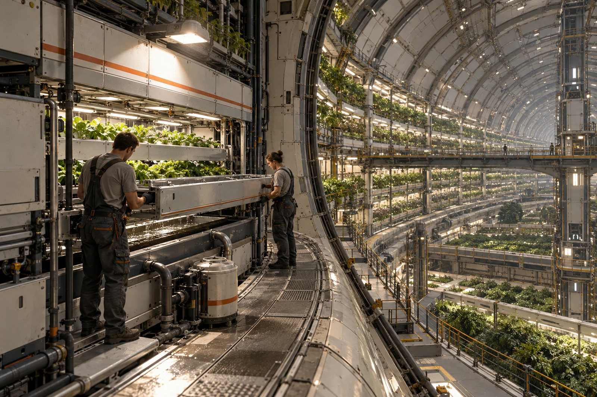

# ARK-01农业维护间 · 支路水账夹页

公元2197年8月19日，航历47年。机组范围：水培支路H-6，隔离片IB-047。其它支路不纳入本页。

## 薄片上的四十七道浅痕

隔离片每次离线清洗后在非密封边缘打一点，今年第47点打在旧点上，肉眼只能数到46。领班没有要求重打。检修次数以工单为准，不以痕迹数为准。密封边缘禁止刻记。

片长1.8米，抽出时两端用导轨支承，液滴沿导槽进入回收盘。照片中种植架背后的上弧是舱体结构，不是露天。人员站立方向以本地旋转重力为准；检修口上方不得悬挂无固定的工具。

## 离线四小时的水去了哪里

| 项 | 千克 | 凭据 |
|---|---:|---|
| 排空收集 | 38.60 | 回收槽称量单 |
| 清洗新投水 | 12.00 | 洗液计量单 |
| 已送净化支路 | 49.92 | 转移罐复秤 |
| 滤渣及湿布带水 | 0.58 | 含水率测定 |
| 当班未回收差额 | 0.10 | 进入误差复核 |

输入50.60千克，当前归账50.60千克。0.10千克是未定位差额，不是已证实泄漏，也不准在总账里写成已回收。滤渣另含干物0.07千克，该量不计在水栏内，送处理间，不送食用栽培液。

隔离片清洗前有深绿薄膜，显微抽样登记三份。第一份观察，第二份留存，第三份空白对照。未完成种属鉴别，工单只写“附着膜”，不用“无害”替代待检结果。清洗液暂存有盖罐，勿倒回H-6。

## 接班者用另一种计数

夜班在页眉写“第二轮长灯后”，晨班添“08:19，02:10”。两处不互相划除。灯周期是农业作业安排，公元时钟是仪器记录。两者对照表夹在本页后，不据灯周期补写检测日期。

种植组问能否提前合闸，答复在密封测试栏：保持停用。旁路承担供水，负荷提高已登记，未改变全船配给额度。居民窗前能看见植物，不能看见净化罐，本工单不引用公共窗景证明水质。

## 清洗工签收

密封面第二次擦拭未见新刮痕，压差保持试验20分钟通过。试验批准支路复接，不批准滤渣回流。复接时刻06:12，隔离片点痕保留原样。

**水账员附注**：差额栏留着。明日复秤，今天不抹零。
