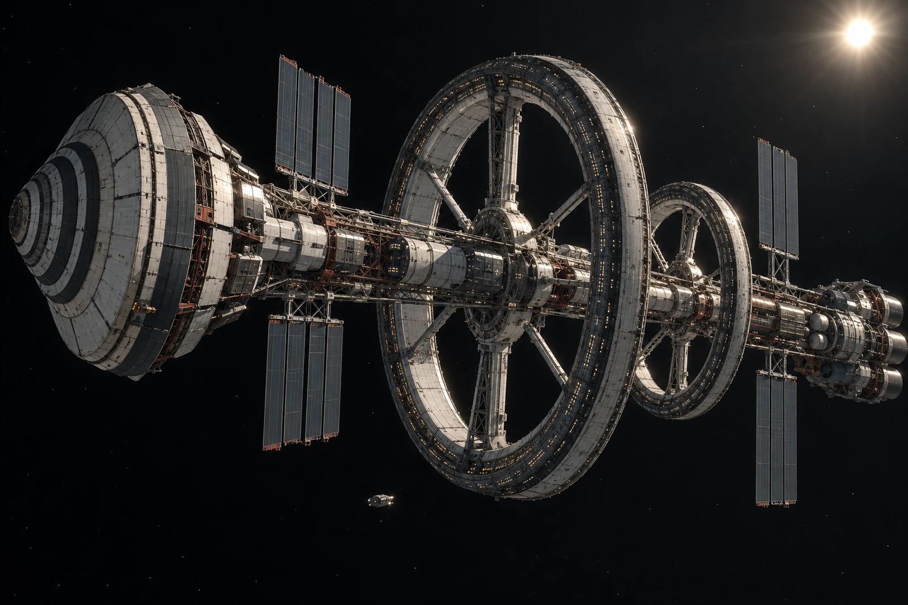

# 太阳系留守接收处 · 第一组外表面图接收联

第六格底色是黑的，原样保存。影像整理员没有把它补成远处的彩色星云，算法推荐图层另行取消。

ARK-01离港后的巡检图按各自的拍摄时刻与接收时刻登记；本联的接收日期不是船旁的“此刻”。留守处收到的是图像和相应记录，不能替随船巡检人员确认它们拍摄以后仍未发生变化。

总览中主轴、前向防冲盾、不等半径双环与侧向热排结构可以相互定位。背景里没有近在船旁的巨大行星，巡航也不需要一条照亮船身的持续长尾焰。那个靠近表面的细小检修器件负责提供位置参照，不把整船缩成图角的装饰。

**接收包拆分**

包内图像十二项，附表十二项；其中一项附表缺拍摄端原始时间字段，暂扣对应图的公开检索。缺项不影响另外十一项已完成的校验，也不能因十一项一致就自动补齐第十二项。

家属联络岗问能否把图中微小人员放大辨认。图像精度不足，未准以生成式补脸满足查询；可提供已有的本人授权联络资料。检修画面中一个亮点不登记为一个新增乘员。

一位经办员将“第一次看见外表面”写成“第一次外表面巡检”，已改正。留守处只知道这组是本处此次收录的第一组，不声称此前船上从未巡检。

第六格打印时省墨，纸面看上去与旁边未印区域相连。档案员在边框外加了小点作格位标记，点不进原图。黑色也有它自己的编号。
