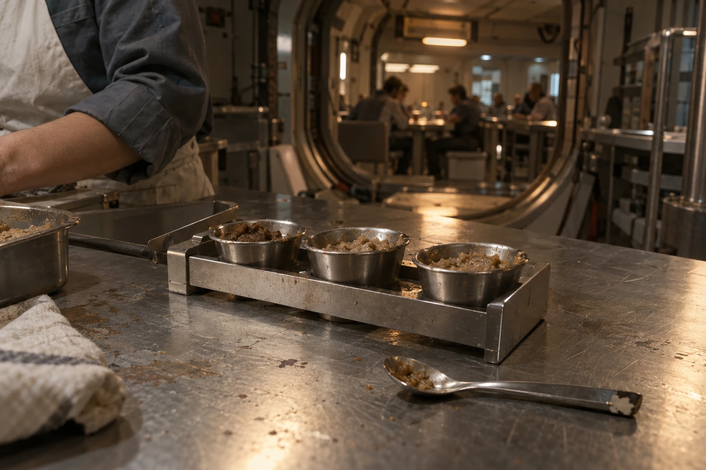

# 第九食堂 · 只借勺，不借名字

十月十六日，晚餐前。试味勺柄口豁一小块，贴胶不卫生，已经拆下。勺面完整，仍可用于封闭试验台，不能回公共自取架。

今天又收到一张“要像下雨后街边烤饼”的点味单。提交人出生地填ARK-01，原乡味觉经验栏空白。我按旧做法把“像”圈起来，没有退单。没有亲自吃过，也可以点。

## 小杯边上的纸

甲杯：基础谷物糊60克，温和加热。乙杯：同料60克，薄铺热板后刮入杯。丙杯：同料60克，混入上一轮合格烘烤粉0.6克。丙杯总质量60.6克，不能在原料回收表里仍填60。

试验原料共180.6克，全部记入试味消耗，没有从本班三人餐份里暗扣。感官试验人均使用独立小勺；柄豁口那把只负责分装，不入口，不在杯间来回搅。

六人试味，三人选乙，两人选丙，一人不选。问“不选”是不好吃还是不像，她说太烫。我把问卷收回来，让她凉后再试；她说不必，晚班要接人。统计保留一份未选择，不改成零分。

## 维修间的回条

热板边缘有一道糊痕，清理掉了。维修员说这不是需要保留的“味道记忆”，积炭会影响温控。下次按相同温度、时长和铺层质量做，不准留一圈焦料当配方。

乙杯用电计量0.018千瓦时，为本次试验记录，不外推成全年菜单成本。食堂没有获准为某种记忆味另增原料；正式排菜还要过营养与加工安全审查，今日投票只作感官记录。

## 署名的小格

申请表“配方发明者”先写了厨务员罗澄，罗澄划掉，填“试制执笔”。热板参数来自设备原程序，烘烤粉来自上一班，点味单也不是她的。若申请公共工时署名，按分工分别列，不用一只勺子归到一人名下。

点味单提交人想带走甲杯作对照。未准，样品只留到本班卫生清场；允许抄下原料与工序。她抄了乙杯的做法，在“下雨”旁边加了两个字：“听说”。

勺归还，柄口豁处朝上。明日当班人一摸就知道是哪把。
