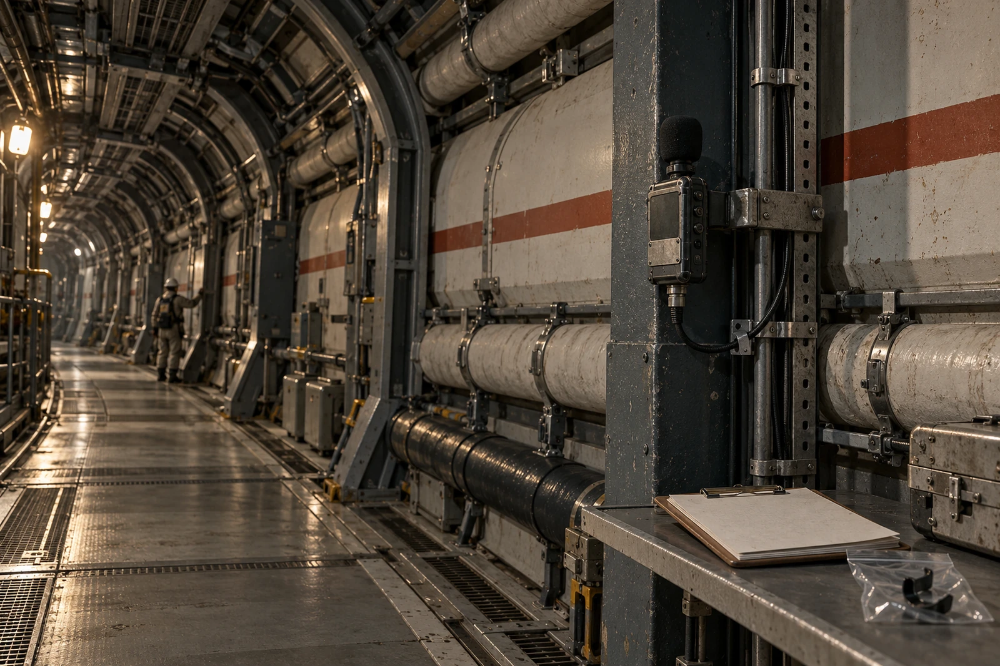

# 管廊听记本 · 借听夹页

2332年5月6日。今天的公时是19:24；记录点的人说“暗灯前第三敲”。我按他们的话写在封面，公时写在里面。不是两份录音。

拾音器借自语言记录组，用固定夹抱住钢柱。没有把接触片贴在承压管上。维修间给的允许范围只到此柱，越过黄框要重新申请。话筒线扣进线槽，扣子太旧，合上时断了一个齿，换了一枚，旧的夹在这页塑料袋里。

## 原音袋里有三件

第一件是未降噪原音，六分钟；第二件是监听用副本，削减低频风机声；第三件是处理参数与校验记录。副本不能覆盖原音。初次导出时漏了开头八秒，已重导，漏头副本留作废标记，不外借。

原音第41秒有两下短敲，第43秒一声长刮。旁边的人把它念成“让路”。第112秒也是两下短敲，没有长刮，他念成“收灯”。我问为什么同样的两下不同，他说“听前头”。前头没有收进这次六分钟。他不让补一句。

## 听记逐行

| 相对时刻 | 所听 | 我的初记 | 核对者批注 |
|---|---|---|---|
| 00:41 | 两短、一长刮 | 让路 | 留 |
| 01:52 | 两短 | 收灯 | 上下文缺失，留疑 |
| 03:07 | 三短 | 换班 | 敲的是支架，不是管 |
| 05:38 | 一下拖尾 | 不记 | 录音夹被碰，不是词 |

本子上“管上三短”的“管”字用黑线涂了一半，仍能读。核对者说以后的人可能只看我的本子。我说原音也在。他让把“支架”再写一次。我写了。

## 借听名单

维修间一人，语言组二人，居民一人，共四次试听。居民只听了前三分钟，退出缘由栏空白。语言组要求另录说话者姓名，维修间建议只记岗位。这一页没有处理权限，姓名另收同意联；未签联的人声不送公共展播。

六分钟占用作业监听窗口，值班员在借用单上签了延迟归还九分钟。原先写“录音故障”，他划掉，说是我没收好线。设备没有故障。我在旁边补签。

## 袋口的字

音频不是整条管廊都能听懂的口令，也不代替安全通信。换班前提醒已由正常通信回路发出。听记本只收本点今日的说法。

晚上送回时，断齿扣子在袋里碰着夹板，响了一下。袋口仍写“非词”。
