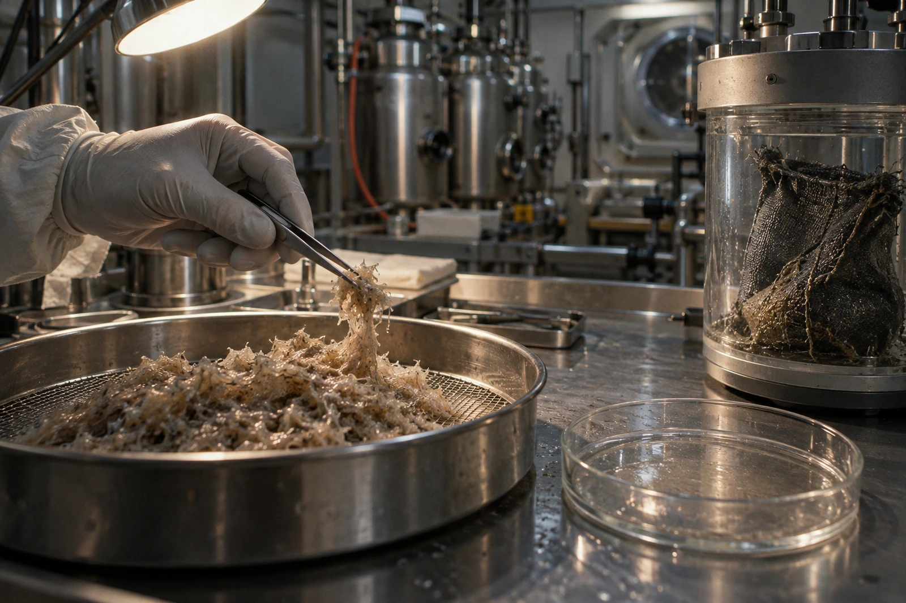

# 降解舱检验台 · 样品F7-263

收样湿质量120.00克。网袋边缘黑色丝束已摄入原始照片，不在扫描清理时删除。送样单写“未降解植物纤维”，显微初检不能支持全部为植物来源，退回更正一次。

本轮只核验送至台面的残留物。不得把一个样袋的结果写成全船降解率。

## 三个称量皿

| 分离项 | 克，干质量 | 台面去向 |
|---|---:|---|
| 可辨植物纤维残留 | 8.42 | 送进一步工艺评估 |
| 疑似袋体聚合物碎纤维 | 1.16 | 隔离待谱检 |
| 无机细屑 | 0.42 | 元素分析留样 |
| 干物合计 | 10.00 | 不含蒸出水分110.00 |

干燥条件与空白皿读数随测量记录保存。110.00克为本次条件下的差减水分，不是全系统可回收净水；干燥尾气冷凝、器壁残留及取样损耗另有处理账。先前摘要把120克写成“全部转化”，已撤。

第七网袋空白抽取试验也检出相似细丝。谱检尚未出结果，暂不能写“来源确定”。同批网袋库存十四只，停用于这一路实验，清洗后转作非生物取样用途须另获许可；不能贴一张“已消毒”就继续投入。

## 一页被退回的好消息

送样员在工艺评价栏写“延长停留时间即可闭环”。检验台要求删去“即可”。本轮未做延时对照，袋体也可能继续掉纤维。工艺组同意先做无袋小样，并补出按周记录的回收物去向。

试验瓶A、B各装同批标准纤维10.00克，A无袋，B用未投产的新网袋；培养、气体与水分记录另表。今日只完成装样，不能预填哪个更快。

## 换班时的手套

技术员右手手套食指有一道黑印，原以为来自样袋；换手套后发现是台沿旧标记。先擦台沿，再重做空白，原空白记录不抹。第一份空白作废理由填“工作面背景未排除”，没有填“操作员污染”。

送样单背面保留旧网袋缝线三厘米，装在单独封袋，不钉穿外袋。那一小段线用于比对，不能再算进8.42克植物纤维，也不作为公众可触摸样品。

接班签认：十四只已扣，库存表已同步；下一批饭后送来的残料改用刚性可清洗筛框。旧网袋还在隔离柜，不在炉里。
