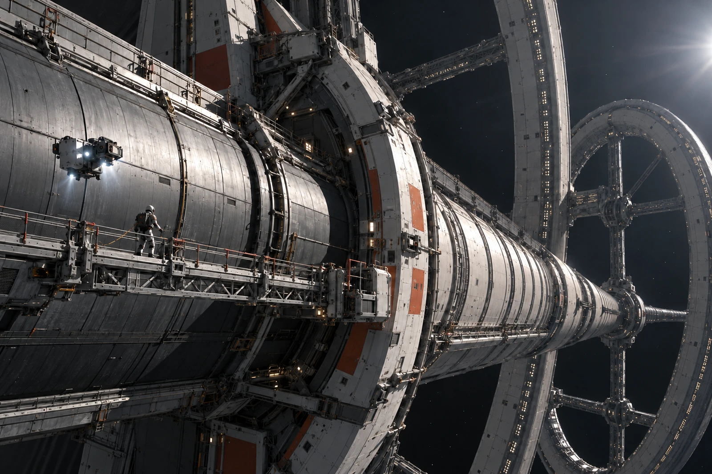

# 非旋转主轴 · 舱外桥使用单

“地板状况”栏填不适用。新到班员先写“干燥”，复核员让他戴着手套将原字划去，旁注此处为非旋转主轴外侧作业面。

本次拆回可卸桥的一段，不拆主轴，不停居住环。人员沿已核认系留点移动，工具与桥段各有独立捕获安排。未装回的那一段只是不能通过，不能用身后的大块船体给人一种“跳过去也会落在上面”的印象。

外场照片保留弯出的主轴外壳、远处环弧以及近侧手孔、系留点和小型巡检器。任何画成下垂的线索须与实际约束对应；真空里没有为构图自然垂下的工具绳。摄影员从非旋转固定点取景，未把环上的视觉方向当作这里的上下。

## 借窗四十分钟

四十分钟是批准使用外场作业窗口的上限，不是保证人员可不看实际生命支持状态的时长。实际进入二十八分钟，余下十二分钟释放给排程，不在人员工时里凑满。原单注明的退出时刻作预计，真实退出另记。

桥段拆下后，一只旧扶手套还在端口。维修组想随废料一并转走，保管员查到它在下班交接卡上仍属工具附件，要求先拆账。扶手套归袋，桥段归框，没有用“附属小物不计”让材料平白少一件。

退出后那名新到班员在地板栏旁又写了一句：“看着像路。”培训岗将此句留作说明，不据此给他记一次违规。实际没有越过封闭点，工具、桥段和人员均按本次单据回收。那条路要到重新装接并验收以后才再叫通道。
