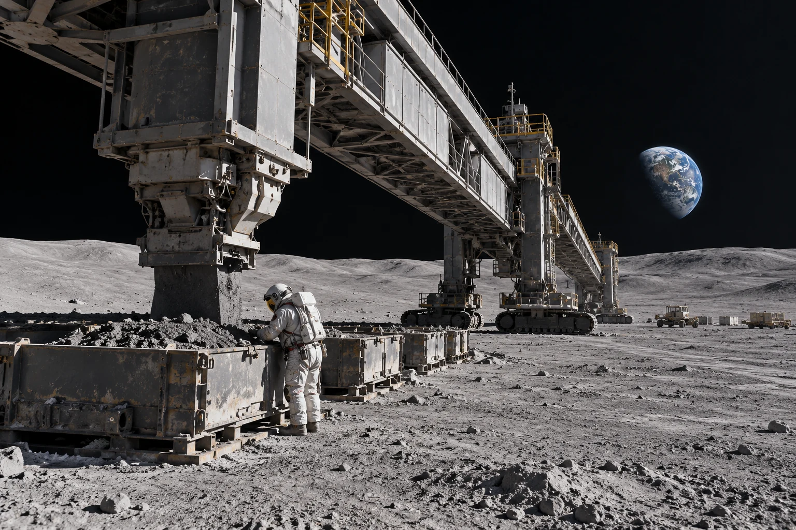

# 沙克尔顿装卸场月壤样盘留样与封存交接单

**签发：沙克尔顿装卸场环境记录组**  
**日期：2044年4月18日**  
**事项：第三装卸带样盘交接**

第三装卸带的旧样盘内壁有一圈未擦去的灰。上一班在盘沿贴了两条封签，一条记录采样时刻，一条记录转运时刻。封签彼此遮住了末位数字，本班将原签连盘保存，不得补写。

| 项目 | 本班记录 |
|---|---|
| 采样位置 | 装卸场外缘，防尘帘下风侧 |
| 处理 | 密封后送实验间复称；未开启前不估算成分 |
| 复称结果 | 样盘含封签总重 184.6 克 |
| 差异 | 与交接联相差 0.3 克，待核对秤校准记录 |

本记录不作为月壤成分证明。装卸架仍可使用，但在秤校准完成前，同位置新样须另用干净容器。值班员在签名栏留下空格，原因是样盘由两班共同封装，第二班尚未复核。

**附件说明：** 摄影记录取自装卸架外侧，远处可见地平线；样盘的灰层没有为拍摄重新铺平。
