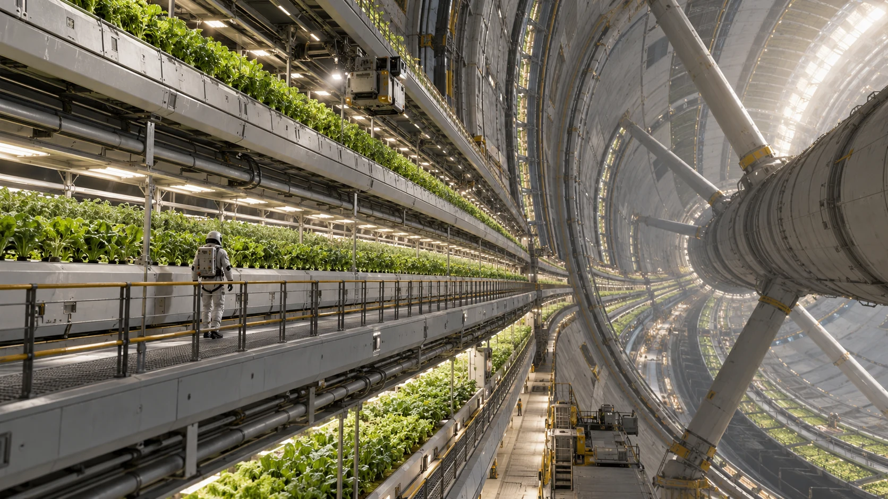

# ARK-01农业环旧种植槽换盆记录

**签发单位：** 农业环维护组 
**记录日期：** 2194年11月23日 
**文件状态：** 交接留存

## 现场记录

一排种植槽更换内衬，根系与旧基质分袋称重。受检槽旁仍在生长的作物不随本次维修搬移。

## 处理与待复核事项

旧衬里清洗后由材料组检查能否复用，排出的水进入既定处理支路。

## 交接

种植员记录换盆时间，水质员独立签收回水样。

## 补充记录

换下的旧基质装入有来源标记的容器，重量包括尚未排出的水分。新衬里投入使用后，种植员记录第一次回水情况；作物长势要经过连续观察，本次维护单不作产量预报。
