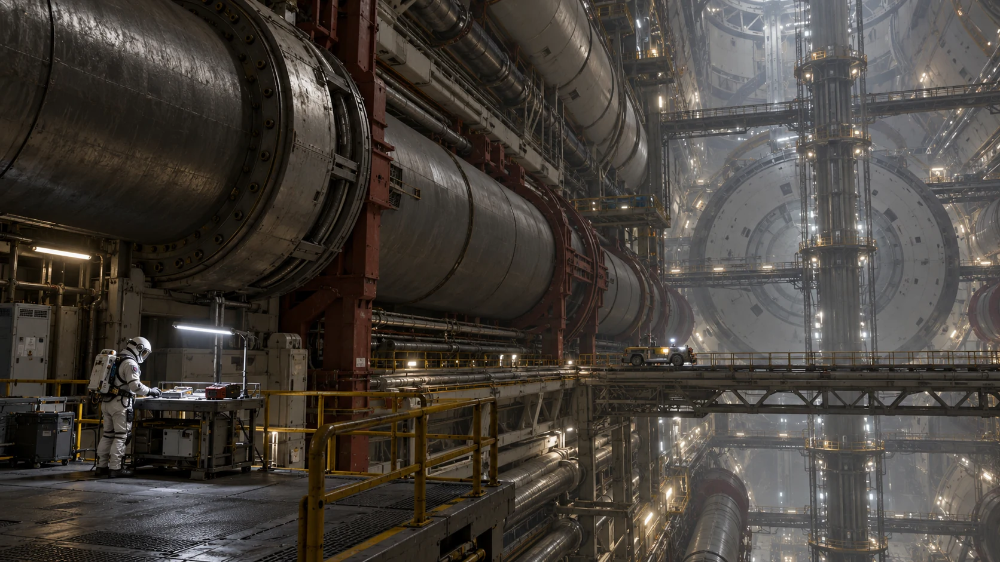

# ARK-01管廊支架振动记录与复检申请

**签发单位：** 船体设施处 
**记录日期：** 2202年1月25日 
**文件状态：** 交接留存

## 现场记录

管廊一处支架在设备切换时出现短暂振动。记录仪保存切换前后数据，目视检查未见掉落件。

## 处理与待复核事项

维护班申请在下一空窗复检紧固点，未据一次记录更改支架寿命。

## 交接

原始波形不得覆盖，复检结果另附；通行照旧，重物暂不靠放支架。

## 补充记录

振动发生时有两台设备依次切换，原始记录包含各自操作时刻。复检时若重复同一工况，须事先征得设备值守岗位同意；无重复条件也应保存现场照片和仪器安装位置。
