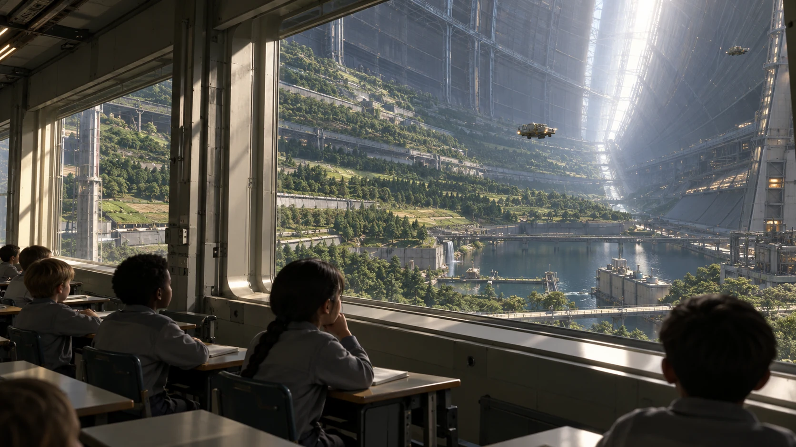

# ARK-01学校观景窗照度测量登记

**签发单位：** 学校设施与课程组 
**记录日期：** 2221年4月1日 
**文件状态：** 交接留存

## 现场记录

教室一侧窗面朝向环内公共空间。照度测量在上课前进行，窗边座位与内侧座位各记一组读数。

## 处理与待复核事项

读数只用于安排照明检修，不能据此评定学生成绩或视力；个体筛查另循医务程序。

## 交接

课程组与设施组各留一份，学生姓名不写入测量表。

## 补充记录

照度计使用前检查校准有效期，读数时注明照明状态、座位高度和窗帘位置。课表安排可能随维修窗口改变，通知只公布时间与地点，不公开学生个体的视力资料。
