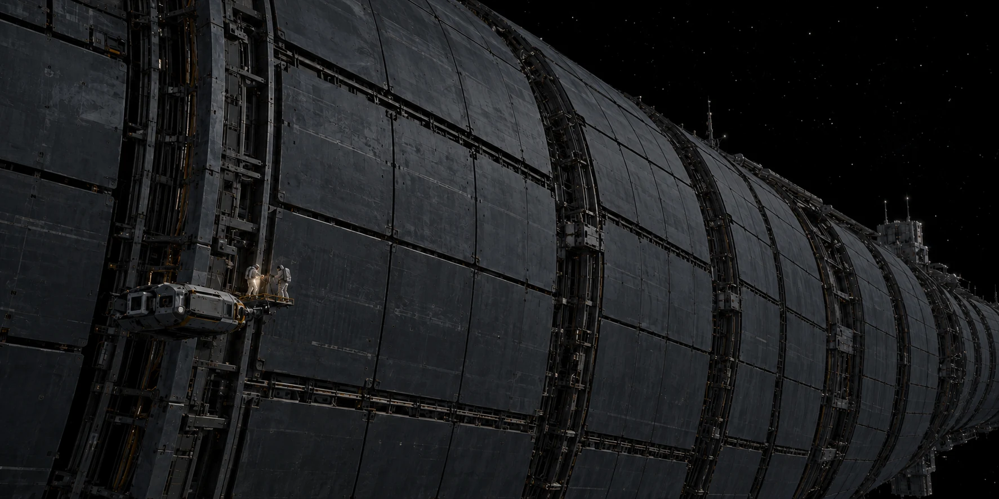

# ARK-01外层防护板微粒撞痕照片目录

**签发单位：** 外层结构检查组 
**记录日期：** 2239年7月4日 
**文件状态：** 交接留存

## 现场记录

外层防护板新拍到三处小撞痕。照片均放入同一目录，但各自保留拍摄距离和照明条件。

## 处理与待复核事项

照片只能辅助定位，深度须由专用测量确认；未出现贯穿的判断也须由检验记录支持。

## 交接

旧照片与本次照片不覆盖，目录中保留各自日期。

## 补充记录

每张照片旁保留方向标记，标尺不得遮住撞痕中心。若前后照片的照明角度不同，亮暗变化不能当作坑深变化；复检计划在航行与外场安全许可的前提下另排。
