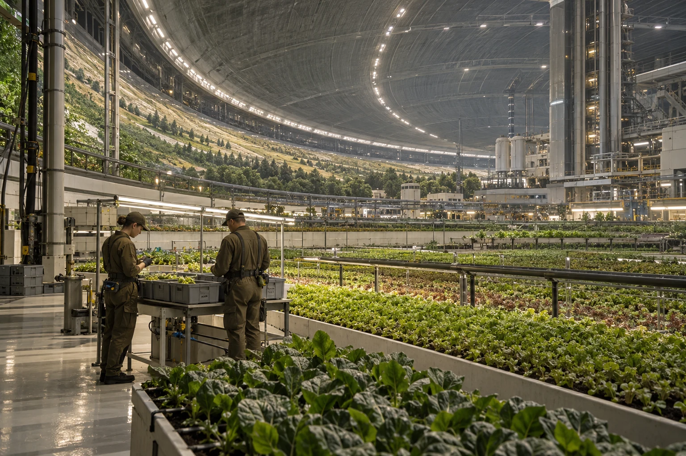

# ARK-01农业环灌溉取样班次与空箱交接页

**单位：农业环水质组**  
**日期：2246年8月4日**  
**记录：灌溉支路晨班交接**

晨班从三处支路取水，样瓶放入同一只带隔板的灰色箱。箱底有一角旧水渍；本次封瓶前已垫吸水纸，不能根据旧渍判断本班有无泄漏。

| 支路 | 取样 | 交付 |
|---|---|---|
| 育苗架前 | 已封瓶 | 实验间 |
| 栽培槽回水 | 已封瓶 | 实验间 |
| 清洗旁路 | 已封瓶 | 实验间 |

返还的空箱先检查隔板，再交晚班。第三格隔板松动，箱仍可转运空瓶，装满水样前须换件。换件工时从水质组维护额度列支，样品结果另存实验记录，不在这张交接页提前填写。

当班两人各签一次：一人对照瓶签，一人核数。空箱回来的时间比样品送达晚，故记录在不同栏内。

隔离片清洗记录见 GS-2197-01；本页只记采样与空箱交接。
