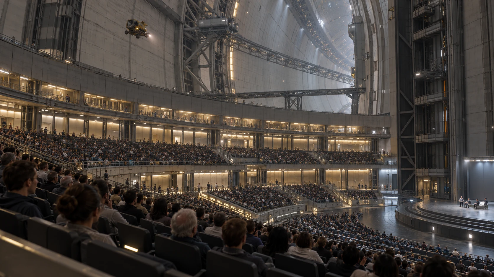

# ARK-01公共厅旧座椅编号补录单

**签发单位：** 公共厅管理组 
**记录日期：** 2283年12月9日 
**文件状态：** 交接留存

## 现场记录

公共厅检修后，四张座椅的编号牌被拆下。管理组对照安装照片逐一归位，其中一张无法确认原位置。

## 处理与待复核事项

前三张恢复编号，第四张暂用临时标签，不冒用原牌；活动仍可按实际座位数预约。

## 交接

拆下的旧牌与照片存入同一袋，待有新的凭据再核对。

## 补充记录

临时标签只用于本次维护，不改变座位长期编号。管理组将无法确认的旧牌放入封套，记录保存位置；后续如果发现互相矛盾的照片，需保留两份来源，不直接删去其中一张。
