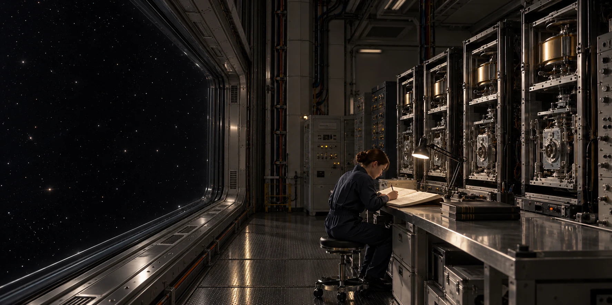

# ARK-01导航计时器交叉比对记录

**签发单位：** 航行计量室 
**记录日期：** 2292年1月10日 
**文件状态：** 交接留存

## 现场记录

两个独立计时器在同一检查窗口比对。读数及测量不确定度并列，检查员不覆盖任一设备的原记录。

## 处理与待复核事项

偏差达到复查条件时，先检查参考装置和抄录过程；航行参数依导航部门程序更新。

## 交接

纸质复核联由两名不同岗位人员签字，一联留计量室。

## 补充记录

比对时记录参考源状态、测量起止时刻和环境条件。抄录更正须保留原数字及更正人签名，不能为了两台设备一致而回写原始日志；后续复查可依据相同条件重做测量。
