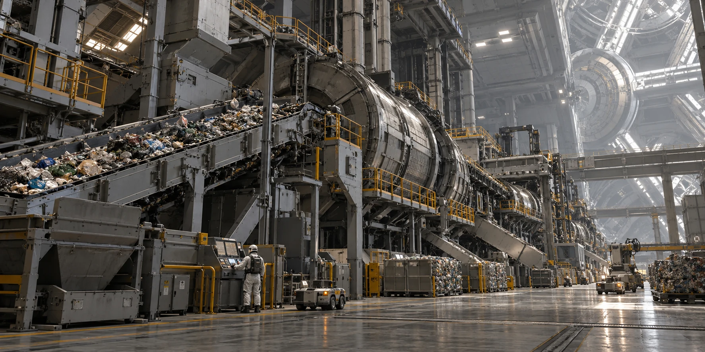

# ARK-01材料回收室筛网换片与余料分账

**签发单位：** 材料回收室 
**记录日期：** 2312年3月12日 
**文件状态：** 交接留存

## 现场记录

分选设备筛网破损后停机，筛上余料及筛下料分别收集。停机前已完成的批次仍保留原分账记录。

## 处理与待复核事项

新筛网经检查后安装，旧筛网称重并送材料组；不把混合物全部算成可用原料。

## 交接

清洁工时和设备复验工时分别签认，接班人确认设备状态。

## 补充记录

筛网上拆下的碎片与停机时残留的物料分开称量，避免把设备本身计入回收产出。替换筛网经空载检查，再按规定进行小批试运行；检验员确认合格前，结果暂记待复核。
