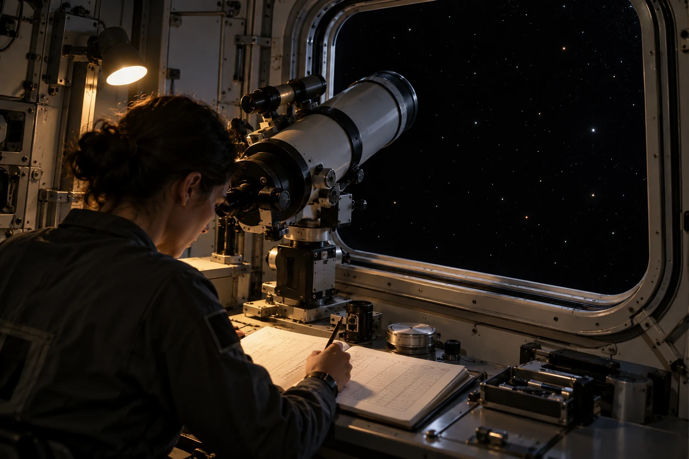

# ARK-01观测窗时标误差与纸质记录封套

**单位：航行观测室**  
**日期：2324年2月11日**  
**记录：观测时标复核**

本班按计划拍摄远方恒星场，用以检查仪器指向。记录纸上第一行的秒数由记录员划掉重写，原因是记录表时钟比仪器时钟慢；原笔迹保留，不覆盖。

| 时间来源 | 记录方式 | 用途 |
|---|---|---|
| 仪器时钟 | 自动记录原值 | 图像对应 |
| 记录表时钟 | 人工抄记原值 | 值班交接 |
| 校时记录 | 单独附页 | 后续换算 |

观测室将三者装入同一封套，并注明校时记录的测量不确定度。未经复核的时差不得直接用于修正船舶航行参数；导航组采用其独立测量程序。

晚班收到封套时检查封口完整，未拆阅底片。桌边的工作灯在拍摄前关闭，在填表后重新打开，灯开关时间记在底片袋外。
