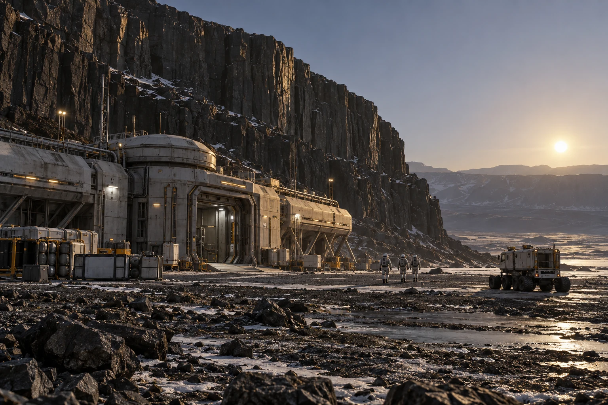

# 比邻星b岩壁实验间采样器清洁表

**签发单位：** 地表采样实验间 
**记录日期：** 2358年6月15日 
**文件状态：** 交接留存

## 现场记录

采样器从岩壁取回后，先在隔离区封装，再按程序清洁外表。空白对照袋随样品一起交实验室。

## 处理与待复核事项

采样工具清洁不意味着样品无污染；后续检验须比较空白对照和运输记录。

## 交接

作业员在交接表注明采样器与对照袋编号，不对岩样成分作现场结论。

## 补充记录

工具清洁记录注明使用的介质、作业顺序和操作人员。空白对照与样品经过同样的运输流程，若对照也出现目标物，实验室需重新评估结果；这一张表不宣布发现新的生命或矿藏。
