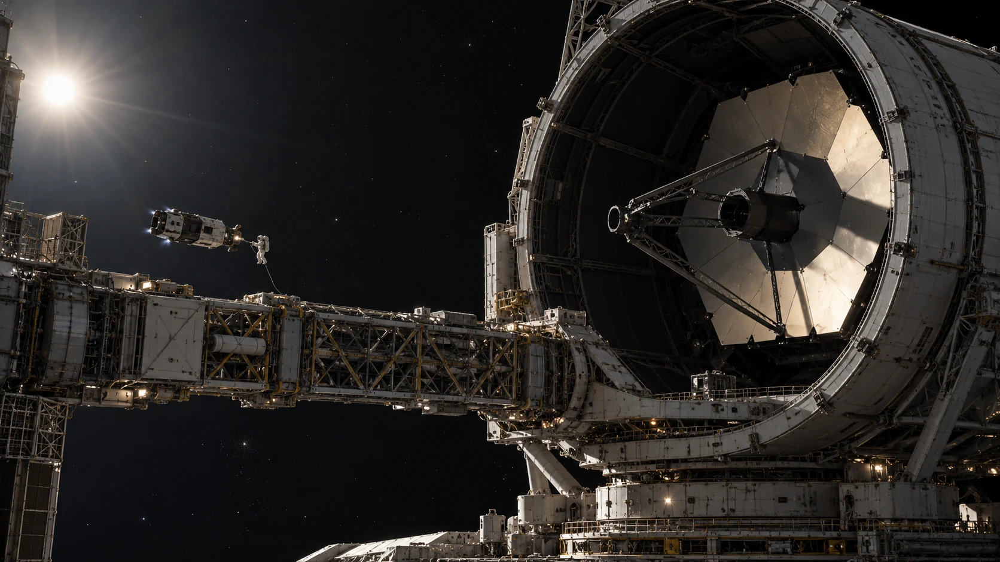

# 星际光通信接收台校时件交接簿

**签发单位：** 光通信接收台 
**记录日期：** 2551年11月20日 
**文件状态：** 交接留存

## 现场记录

参考件从柜内取出校验，取出时间与返回时间分别登记。设备的时标与人工记录时标并列保存。

## 处理与待复核事项

本台完成校验不等于对端同步完成；跨站比较须等待对端数据到达。

## 交接

校时件交回后检查封签，任何缺页均在交接簿标明。

## 补充记录

参考件取出前确认温度已达到操作条件，取出后不将其放在普通货架。对端数据抵达后再比较时标与测量误差；迟到的数据按原始记录保存，不能用接收日替换实际测量日期。
