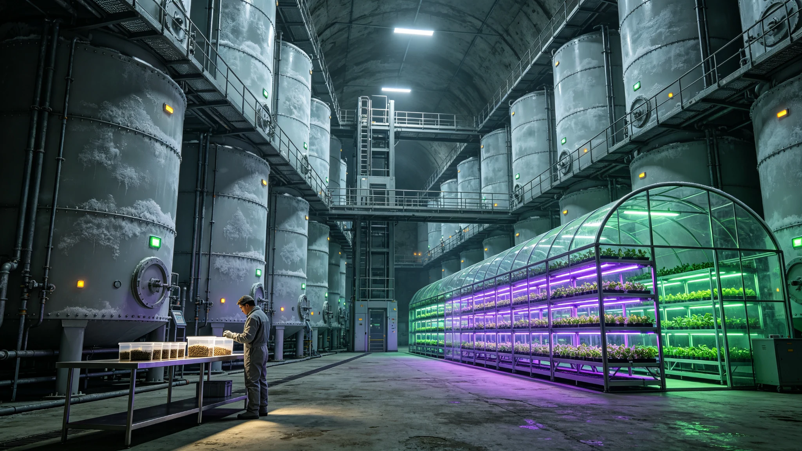

# 跨恒星系种子库扩建与深空辐射育种技术应用公报

**发布机构**：跨恒星系农业科学联合研究院 / 深空遗传资源保护中心
**文件编号**：AGRO-2943-001　**日期**：2943年3月20日　**文件等级**：全球公开

跨恒星系种子库（位于内奥尔特云"玄冥-01"远征母港地下300米的永久冻土层中）第三期扩建工程于2943年3月15日正式竣工。扩建后，种子库总储存容量从原来的500万份增至2,000万份，成为人类文明最大的遗传资源备份设施。

## 一、扩建竣工表

| 设施 | 数量 | 规格 |
|---|---|---|
| 超低温储存舱 | 12个 | 液氮-196°C，每舱150万份；合计1800万份 |
| 深空辐射育种实验室 | 1座 | 配备高能质子加速器+重离子照射装置 |
| 基因测序与数据中心 | 1套 | 12.8万亿次/秒运算能力 |
| 隔离种植试验区 | 16个 | 全封闭加压种植舱 |

上述单舱数值为标称上限，库区实际额定总容量以工程验收值2000万份为准；本表不据单舱上限推算可用总量。

## 二、样本存储表

| 来源 | 份数 |
|---|---|
| 地球原生作物品种 | 128万 |
| 野生植物种质资源 | 340万 |
| 比邻星b驯化品种 | 45万 |
| 火星温室选育品种 | 22万 |
| 鲸鱼座τ星人工生态品种 | 18万 |
| 其他深空定居点品种 | 37万 |
| **合计** | **590万** |

## 三、育种成果表（2935—2943）

| 品种 | 性状 | 应用 |
|---|---|---|
| "深空-1号"小麦 | 产量+42%，蛋白质+18% | 比邻星b推广800万公顷 |
| "辐射-7号"水稻 | 耐盐性↑，0.8%海水浓度可生长 | 海洋农业开发 |
| "星桦-3号"速生树 | 生长速度2.3倍，木材密度+15% | 造林、碳汇工程 |
| "深空番茄" | 维生素C 3.2倍，抗氧化+2.8倍 | 深空航行生命保障 |
| "抗辐射-2号"大豆 | 叶片损伤率-65%，产量稳定 | 比邻星b强紫外线环境 |

选育周期平均6.2年，比传统育种缩短约50%。

## 四、样本调用台账（原行摘录）

> 样本调用台账 · 2943 · 台账编号 调-2943-全
> 2943-01　调用方：比邻星b农业研究所　样本：深空-1号小麦种子1000份　用途：育种试验　审批：签名略
> 2943-02　调用方：火星生态局　样本：辐射-7号水稻种子500份　用途：种植试验　审批：签名略
> 2943-03　调用方：鲸港生物实验室　样本：星桦-3号速生树种子200份　用途：造林试验　审批：签名略
>
> 年均处理研究用样本调用请求3,200余次。远端申请及审批回执按实际抵达时间入账，不以登记日期推定跨星系即时送达。

## 五、管理原则

| 原则 | 内容 |
|---|---|
| 备份保存 | 所有样本双份备份，一份长期储存，一份研究取用 |
| 主权保留 | 样本提供方保留种质资源主权，第三方使用需授权 |
| 利益分享 | 商业化收益的15%返还给原始种质资源提供方 |
| 紧急调用 | 行星级生态灾难时，任何定居点可申请紧急调用，事后补审批 |

已与比邻星b、火星、鲸鱼座τ星等8个定居点签署遗传资源共享协议。

## 六、岗位按语

> 深空遗传资源保护中心注：种子库是人类文明的"农业诺亚方舟"。深空辐射育种让我们在宇宙的辐射中寻找新的生命可能性。

---

**发布机构**：跨恒星系农业科学联合研究院　**会签**：深空遗传资源保护中心
**日期**：2943年3月20日
