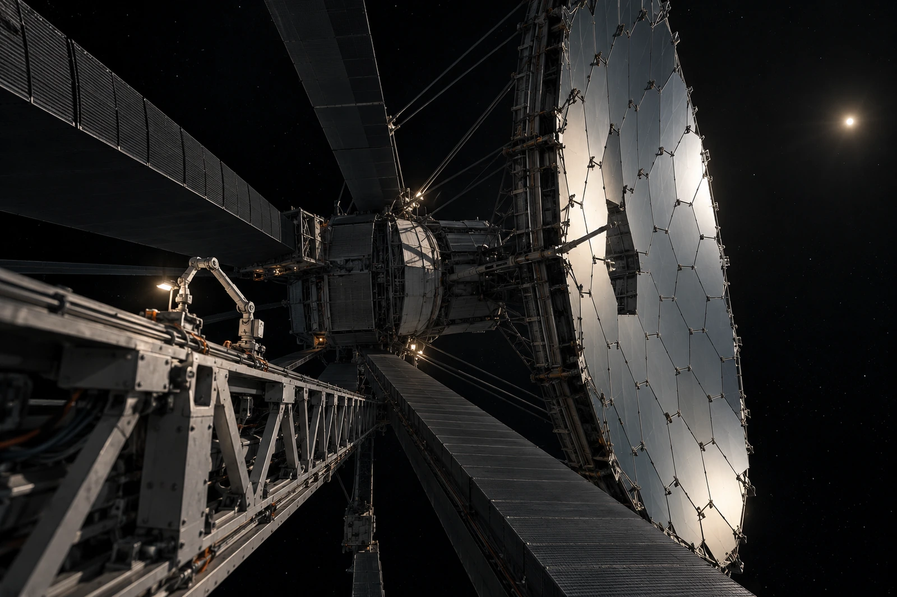

# 信标07外场 · 接收静默单

主镜已展开，首班未收到期待的回报。未回话不记作镜面未展开，这两项有不同证据。

本站位于七十二点四天文单位一线，沿用原主镜三十米口径身份；本班增加的是维护记录，不将镜子在展示图里放大成几公里。近端机构、附着检修器、遮光翼与主镜提供尺度，太阳只是远处小亮点，不在镜后加一个不存在的邻近行星。

## 三次动作

1. 复核机构状态。
2. 取得本地影像。
3. 登记接收等待。

三次动作不能排列成“发出、即时答复、验收完成”。实际信号传播与处理时间按记录分别保存，屏幕可以即时更新本站状态，不能把这份更新当作远处的答复。

一张训练用指向示意把通信画成绿线，值班员要求从物证图撤出。真空里没有散射给镜头看的整条光路。方向、波段与运行参数在附表中，不靠发光颜色证明。

原始广角一半黑底，图像员问要不要裁成全是设备。工区保留原幅，另做带机位说明的局部查阅副本；空出的深空也是工作环境，不能让读者误以为相邻结构近在伸手处。

临时盖板借出四块、收回四块。每块都有自己的归还格，不因镜面已经可见便省去盖板清点。首班工作结束，值班台收到新的本地状态消息，仍不是等待中的那个回报。

静默栏在下一班继续。没有按零丢包填，也没有写通信已中断。
