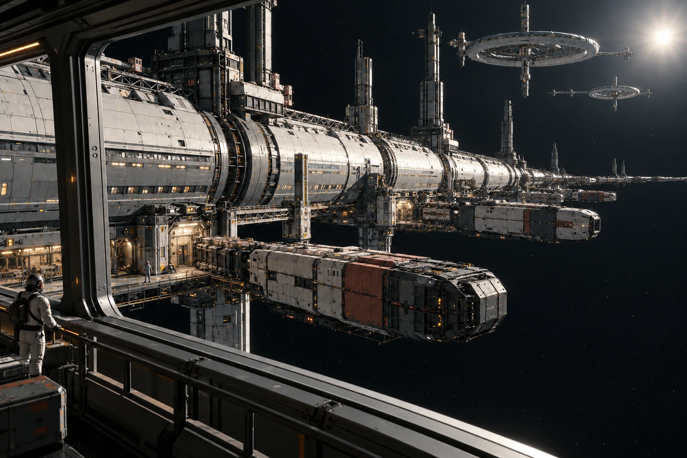

# 三站共用港 · 滞留家属休息联

同一块席位牌有三站的收件章，只有当前值班处的占用登记有效。三枚章不代表同时拥有三张床。

接驳排程变更，家属在中枢压力区等待。窗外是开放的泊架与分立转运点，远处旋转住区各自运行；靠港大厅不因此变成把三站日常一起包在里面的一座有重力大城。公共区与外侧无压作业面在图上仍有完整边界。

## 时间分账

本站发出、本站接收、对方预计到达与对方实际接收分别保留。家属手机将另一站的班次显示换成本站时标，工作人员附换算说明，未把原字段覆盖成“只有一个正确时间”。这不是实时跨恒星系通信，当前联络范围按实在的港区与原调度处理。

本班实际暂留：十一人。

- 领取餐份：六人。
- 申请休息位：四人。
- 只取行李保管凭证：一人。

三项服务有重合对象，不把六加四加一当作核对人数的唯一办法。签到表用实际人员清点，消费项目另算。

全景图中有三个不同功能泊位，不依靠相同小船复制出繁忙感。载具各有封闭结构、对接点与空开的航道，待机者没有一起喷出亮焰。墙上展示图的反射遮住一处近门，原图保留，导向版另用现场平面说明。

一个孩子把席位牌当成转乘票握在手里，收件员解释后把两件凭证分别套好，没有将家属误领处理为违章。席位实际退还才销号，下一站已收到通知也不替这里的人离开椅子。
