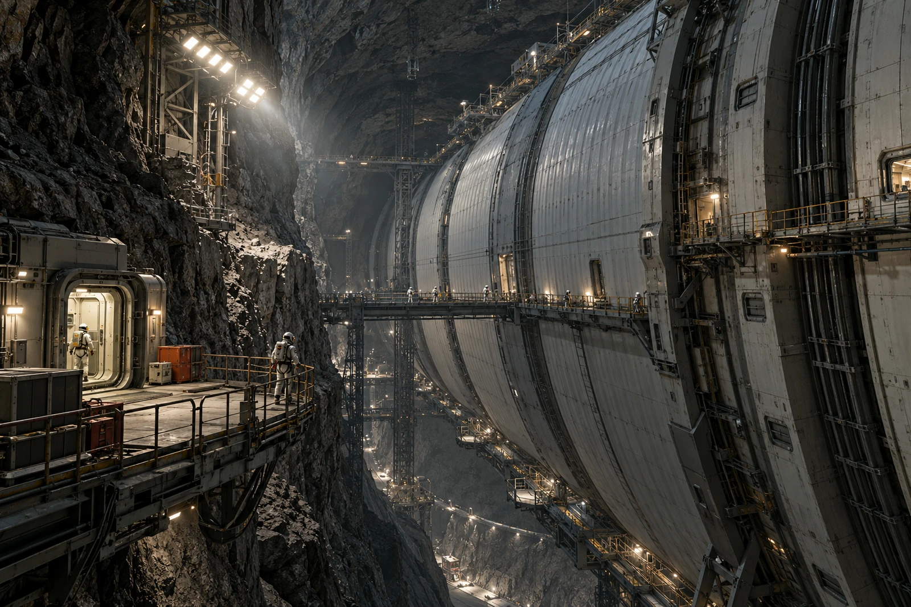

# 岩腔居住站 · 岩壁空隙禁住告知

壁上检修标记不是房号。申请人将那串数字写进迁居表，窗口退回地址栏，不退回其排队资格。

开挖岩腔围着独立压力内胆，内胆与岩壁之间的空隙用于检查与设备维护，并非已获准居住的公共大厅。岩体可以遮蔽，也不能仅凭它把整片裂隙空腔认作气密承压空间。未着舱外装备的人员不得因“已经在山里”就越过压力边界。

## 本班说明图

近端工作门、内胆肋骨、检修间距与整片岩腔都要看得见。画面可以拍得很大，不能把压力内胆抹去只剩裸岩下的餐桌。外侧检查人沿受控系留点移动，内侧住民透过规定窗口可见，不出现在同一无压作业面。

收到迁居询问五份，其中两份误写检修标记，均更正后继续受理。安置人员不把地址误填登记为违占，现场也未发生有人擅住空隙的情况。留证照片只展示空间状态，不凭一只临时工具箱就推定曾有人在此居住。

本日气密与结构检查按各自工单进行，本告知不替其签收。窗口人员在表上勾了“边界已说明”，申请人签的是收到说明，双方都没替工程岗位保证内胆永不泄漏。

原标记牌卸下后装在透明套里，另设较清楚的检修识别。那串数字继续留在设备历史记录中，住宅门号另行分配。住民无需在旧牌背面补一份虚构的入住日期。
