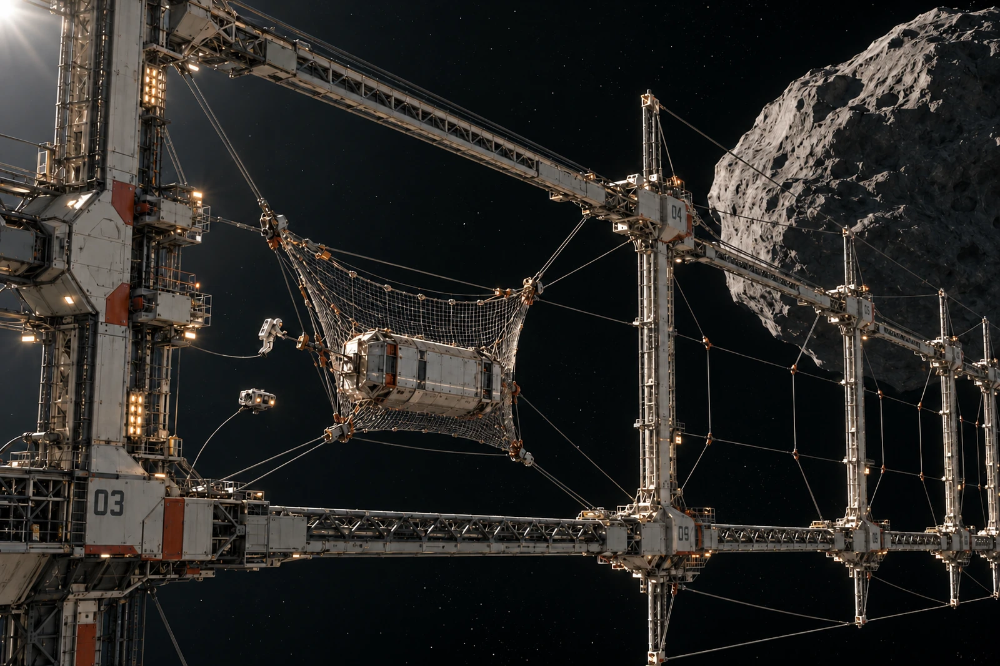

# 缓速货包捕获框 · 空位暂记单

第九位仍空，吊签没有重量。空位清点不能填零质量货包，那会让接收数凭空多一件。

本班一只货包进入局部捕获网，捕获状态、机械约束与接收身份依步骤分别确认。网不用于从远处接住高速飞来的散石，货包接近条件须由原调度和操作记录支持，本单不以照片里的静止姿态追认此前的速度。

全景保留外框、分散服务支架与大片黑色空隙。近处工作扣、货包外壳、检修器与远处矿体连续提供尺度。柔性网依实物张力变形，不因绘图习惯垂成一只朝下的袋。作业者在受控点上，不在框边奔跑。

## 两种空

| 位置 | 设备状态 | 货物状态 | 本班调度权限 |
|---|---|---|---|
| 第九位 | 可用 | 无货 | 可按许可排货 |
| 第十一位 | 检修 | 无货 | 不可排货 |

原目录都写“空”，调度据此分配了第十一位。值班员在货包仍未释放原约束前拦回排程，更正未到货位状态，无需编造一次碰撞来解释停下的必要。

打印工将第九位吊签拿去称重，得到纸与封套质量。计量岗将该数退回，它属于附件，不是空货包净质量。纸联留着这次误测的原始单，未揉碎重打以求整洁。

实际接收一件，新增空位零件；检修位置一处待恢复。装卸费按实际完成的服务项目结算，不按“框已铺开这么大”分摊一圈虚拟货物。

吊签重新夹回第九位目录袋。以后有货来，另填它自己的重量和移交时刻，不借今日空签的签名。
