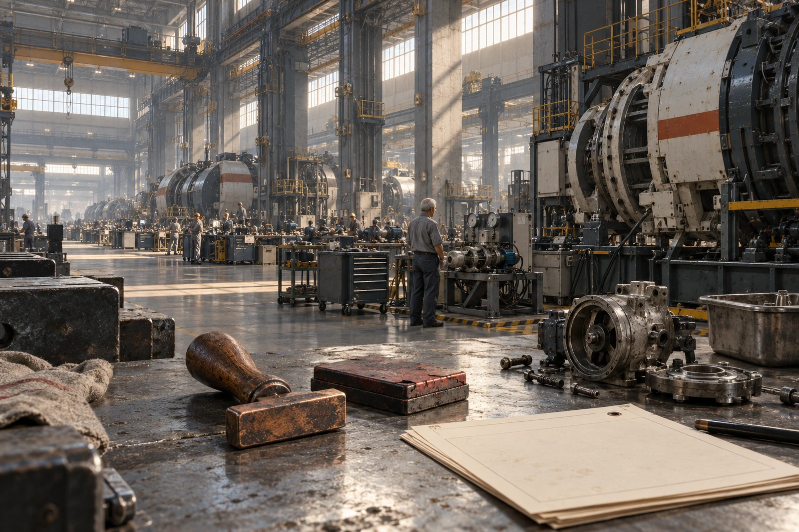

# 南岸综合体公共修理所

**工时复核存根2073-春-083**　申请事项：循环小泵维修，共同具名名额二。

## 退回的印章

窗口收到一枚铜章。章面下沿磨平，盖出来只剩“秦”字上半部；申请人附注“章没坏，人名也没改”。印泥盒底有干硬裂缝，盒内未加水。受理员把实物装袋，纸面先写姓名，印样贴右侧，不凭残字拒收。

所修小泵编号SA-P-883，用于公共温室支路，不用于医疗。来件吸入口粘着四根细根，叶轮边缘有一道刮痕。机器先切断电源并清空积液；申请人秦绵负责拆洗、校核密封面，轮值机器负责轴端同心度复测。维修后的泵不归秦绵，归原温室。可分配的是本次劳动的具名资格。

## 同一张记录的三个时钟

| 记录源 | 起止 | 记入分钟 |
|---|---|---:|
| 门禁 | 08:12—11:54 | 222 |
| 工位占用 | 08:26—11:41 | 195 |
| 本人有效作业 | 两段累计 | 126 |

门禁包含排队、领工具和饮水；工位包含机器独立运行的69分钟。有效作业126分钟，其中独立拆洗74分钟，共同测试52分钟。申请人原将222分钟全写入具名栏，经出示工位存根后改填126，未撤申请。

依现行三级分配表，74分钟记具名，52分钟记共同具名。两名观察者各看了26分钟，不以旁观时间争取维修署名。基础配额不受此项核减影响，午餐领用记录保留原数。

## 申请人补述（窗口逐字录入）

“我没说机器修不好。是它修好了以后，牌上没有我的地方。我去年带着这枚章来过，叫我先排队。我排到今天，章盖不清了。”

补述不作为增加分钟的证据。窗口将旧印样与新印样并排归档；下次受理可凭工号复核，不再要求铜章字口完整。申请人问旧章是不是应上缴。答：留样摄影完成后返还。

## 复测单的反面

10:57初次试转，密封处有湿痕，停机。11:14更换密封垫，11:26重新试转，11:41结束。返工十五分钟已含在126分钟内，不另加一次。试转所耗水4.2升进入回收槽，台面擦拭布称量并入清洗科目。

承办员签“许玟”，复核员签“贺九”。申请人落款先盖章，随后补写全名。旧章收件袋已经划上返还日期。

**窗口批**：准予按126分钟结算。工位仍用机器。名册增加一行。
