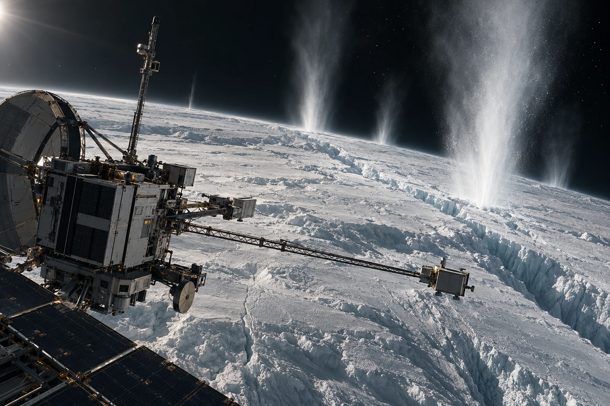

# 南侧无人采样阵 · 返样封存单

封签没有“发现生命”一栏。提交目录的自动摘要加上了这五个字，本地复核未采纳，原摘要留作差错附件。

采样设施按既定任务保持与喷口的工作间隔。远处自然喷出物向真空展开，近端载体的采集片、仪器臂与机器人连接明确，不在裂隙边画一排无防护人员。喷流不是设备发出的蓝光，影像处理不得把粒子散射画成一根实心柱。

## 样本身份

| 收件类别 | 件 | 分析栏 |
|---|---:|---|
| 采集片 | 4 | 待后续岗位处理 |
| 空白片 | 2 | 待后续岗位处理 |

分别封装。收件岗确认本批载体身份与封装状态；四件采集片不等于四种生物，空白也不能因为“本应无物”就不计污染控制。

一件片边缘有不明浅色痕，图像员在目录中圈注原位置，不用生成式增强补出细胞轮廓。化学、结构与污染排查各保有自己的证据链，封存单不承担最终解释。

全景取自远距平台，近端设备的门板与维护机构提供尺度，远处冰壳裂隙与自然喷出区指示位置。没有通过把载体贴近地表来显得勇敢，安全间隔按实际任务参数核对，不用一幅图臆算距离。

封存介质的两份校验值一致，只说明当前两份记录对应，不证明样本在运输中从未改变。原始采样时间、各次转移与本次本地登记分开保存，末页不将这些时刻合成一个“发现时刻”。

本组至此完成返样收件。分析栏空白，留给实际接样的台。
