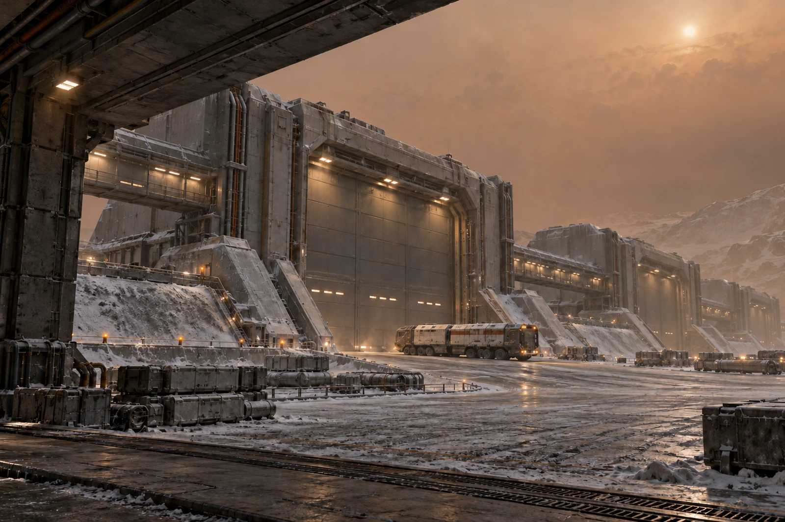

# 土卫六密封仓 · 等待擦读联

货签擦了三次仍未判读，状态填未判读。不凭箱体排列顺序替它填上旁边那只箱的号。

低能见度等待安排只对本次坡道转运有效。密封车辆停在获准等待位，仓门未开；司机留在压力边界内，不出车用手给镜头比划。远处仓体、绝热管廊与近端装卸坡道在橙色低对比环境中仍应能定位，照片不能凭喜好改成蓝天明亮港城。

## 到货而未交割

六只箱到装卸区，五只身份复核完成，一只货签待判。原单印“六箱收讫”，收件人拒签，改为六箱到区、五箱受理、一箱待核。承担等待的车辆不因为签不齐便被算成未到场。

结霜外观随现场图保存，货物温控是否合格须查相应记录。擦净一张签不能替整箱温控签字，结霜也不直接证明内装报废。货方与仓方各持一联，未由本地摄像画面给远端买方作最终质量裁定。

第三次擦读使用的软片留在操作袋，工具员注明其处理与去向，不再把它送回洁净签材盒。记录人曾把未判读栏写成“无标签”，改后两字仍可见；实物上明明有签，只是现在读不清。

班尾五只受理箱按原流程进入，待核一只仍由约定责任方保管。没有让未知身份的箱子在夜里先找个空位放好，再留下一张“请明早查”的纸。
