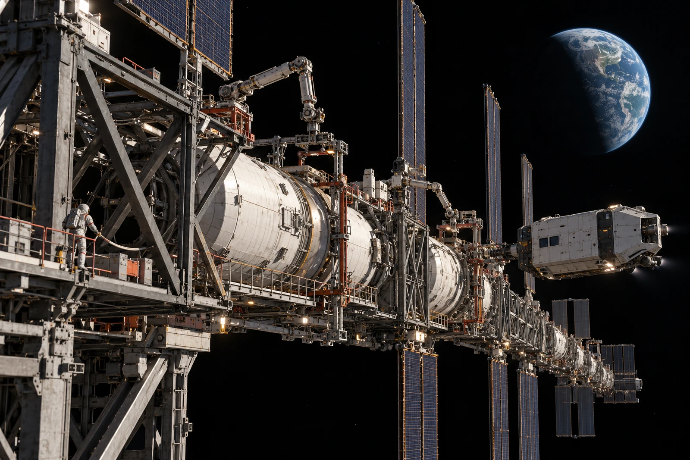

# L1前哨外侧捕获架 · 靠泊调度单

旧箭头已划，不回收旧图。来班接到的直线进港图穿过了一处正在占用的捕获臂活动范围。两架看起来相邻，分属不同工序，不能从空着的那一边擦过去。

物料筒改在外侧等待点保持约定状态，由本地调度重新发出接近许可。转运艇是封闭载具，等待不等于乘员可以出舱蹬住货筒。工区同意多用一个班次，不同意以临时人手代替正向捕获约束。

远处地球只占画面一角，近处桁架贯穿数层工位，压力舱和捕获点才是作业位置。摄影员从固定平台拍摄，艇体、对接口、人孔和人员系留点形成尺度顺序。无轮子，无落地，无“吊起来”的箭头；活动件的约束方向随实际连接画。

**新旧班次核对**

原班应交货筒两只，现场两只均仍在约束位；新班实际接收一只，另一只待窗口。入库不可写两只，旧班也不可把第二只划成遗失。占用捕获臂的维修工作另有未结工单，没有被货运调度撤销。

一名换班工在纸上把“外侧”等待点圈成“上方”。下一名读图人将纸转过半圈后指向另一处。两人共同把字改为具体标志位，原圈留作示例。这里没有一个可以只凭上下二字固定的方向。

调度员末签：新箭头只在本窗口有效。捕获臂一旦改变状态，重发许可；不许把今日图剪成口袋卡，留着下个月继续走。
