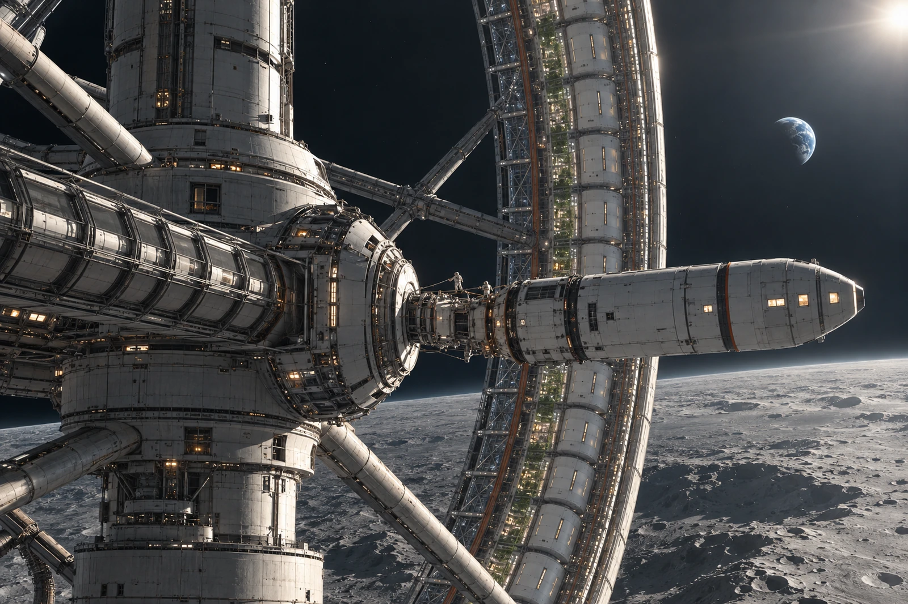

# 外环补给通道 · 居民候船联

儿童鞋扣在候船名单下，保管员没有把它列为遗失行李。母亲说等过门再装，怕孩子把这边平台当成居住环地板。鞋扣只在适用作业面使用，不能替任何人保证到处都有向下的重力。

补给艇在非旋转中枢靠泊，居民环仍按自身状态运行。今天改的是补给与居民转乘窗口，环体不因一张调度单停转。连接段的通行状态由设备值班员确认，候船窗口不能看见桥亮灯就自行开门。

等待名单十七人，实际到场十五人，一人改签，一人尚未报到。自愿让出座位的居民仍保留原候船号，不从名单上消失；未报到也不先写成已安全抵达下一处。两位负责清点的人在不同栏签，免得照同一份误数抄两遍。

## 窗外的环

透过中枢工位能看见栖息环巨大的一段弧线，近处对接结构、转乘接口和维护人孔连到远端压力舱。只有靠泊点上的小艇属于这次补给。窗外另一只维护设备不是多出来的候船车，不从照片数量倒推载客能力。

一张候船联被折成窄条，背面画了环，孩子问是不是要“坐那个圈走”。窗口让监护人带他看本次线路图，没有把整个环标成车辆。图上只画实际会经过的接口，不借机会讲一次未来远航。

鞋扣随人归还，十五名已到者中十二人完成转乘，三人继续候位。旧名单末栏没用完，仍留空。补给艇已固定，门还没有为下一组三人打开。
