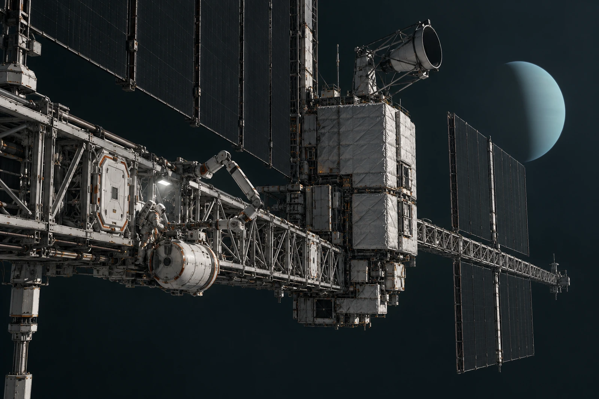

# 天王星外侧中继架 · 本地代理签认表

远端签名格空着。本地代理员不在那一格签远端负责人的名字，也不以回路仍能传数据证明对方已知本次维护。

低温检修由现场受控系统执行，设备状态、动作结果与等待远端审阅分别记录。调度端发出过指令，不替本地机械接点实际完成复核；本地已经动作，也不抹去尚未收到的远端确认。

总览从近端检修梁向外看，标准维护门、捕获机构、光学接收器和外侧热排构件依次延伸。天王星只作远处淡色圆面，表面不添城市光；相机旁检查灯只照近端工作部位，远处暗面保持暗，不用太空雾把距离涂出来。

**代理权限页**

本次授权拆检一处连接、替换一只已登记部件，异常范围外停止并保存状态。代理程序遇到第二处读数差异后暂停，未自行把整排接头列入更换。库房把未用备件保留在受控位，没有为“让这一趟值得”追加无授权工作。

替下的旧件装入原定容器，容器外封签与遥测副本分别编号。两个编号并存，不能让读者误以为传到远端的数据包里也装着实物。转存回路的字节一致，旧件现状仍须查本地保管记录。

窗口操作员的值班章少了一角，先试印作鉴别样，再在本地代理栏盖章，远端栏依旧空。损角不填成对方未签的理由；真正的理由是尚未收到。

表尾记录本地工作结束时刻。外侧桁架仍在黑暗里等下一次许可，不替远方的人加速回答。
