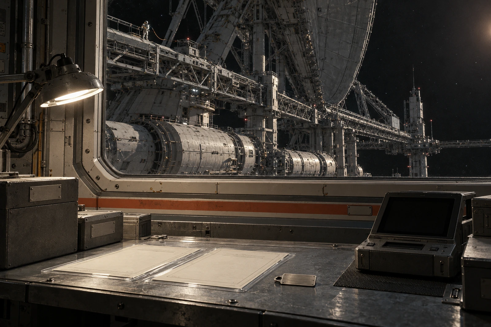

# 比邻星档案接收站 · 迟到回执簿

记录日2684年10月2日。太阳系维修档案交换批S-2671-40；本地接收封签P-2675-40。两端时间字段不得合并。

## 今日收到的不是今日答复

太阳系发出交换批：2671-03-01。本站收讫完整副本：2675-05-29。本站当日发回校验回执；太阳系确认收到回执：2679-09-04。确认件今天入本站簿。两次从本站发出到再到本站，分别受排队窗口与光程约束，不能用太阳系确认日期伪作本站到达日期。

两恒星系光程按4.24年下限核对，往返下限8.48年。该确认件在2684年10月2日登记，晚于下限，不构成超前到达。发端日期按对方时标转换，原始字段仍保存；这里不讨论谁把“今天”说得更准。

## 数据袋里两件东西

一件是静海CW-17见证砖的旧照片及称量单，档案GS-2041-03；一件是第六维修坞梁端铭牌侧光照片，档案GS-2066-03。交换的是副本，砖和铭牌没有装在星际运输箱里。本站纸盒里那块新金属片是本地保管封签，不标为古物。

CW-17主样4.342千克、碎片0.018千克的字段相加为4.36千克，与旧卸料秤数一致。接收软件曾舍入到两位小数，显示4.34与0.02；展示页看着也能相加，仍不能取代原精度。复核员把舍入显示关掉。

## 校验表

| 包内项目 | 结果 | 收讫权限 |
|---|---|---|
| 原图与原始称量字段 | 校验值一致 | 可存真 |
| 梁端牌“24/29”差异注记 | 两条均在 | 可供查阅 |
| 本地整理的解释页 | 非发端原件 | 另库存放 |
| 物件现存状况 | 未附新验物单 | 不予确认 |

“校验一致”只证明此副本与发端所声明的字节相符，不证明六百年前的称量准确，也不证明原砖今天还在。上次目录把它写成“原物在册”，今天加挂更正，不改旧目录历史版本。

## 迟到之后的权限

太阳系确认件所列经办员已经离岗，本地不能向现任人员索要前任签名。本站换了两名值班员，收讫责任按各自操作日志追踪。相同工号不等于同一个人；代理签章不补到旧回执上。

借阅人申请：“请问那块砖还在吗？”请求登记，待下一个发射窗口发送。回答栏空白。软件给出预计最早返回年2693，旁注“窗口与处理时间另计”。

**值班员盖章**：今日确认，副本在此。原物所在，待问。
