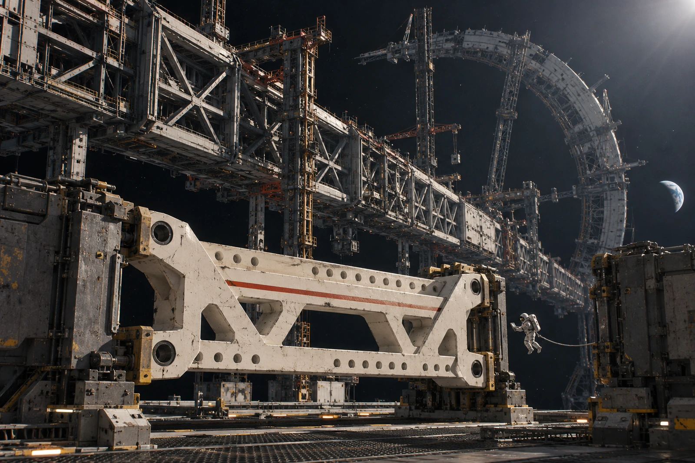

# 建木船台 · 接口卡K-46

工程对象：ARK-01主龙骨一处隔热支座。**本卡只确认此接口，不签整船。**

## 镜头先于螺栓

11月8日03:42，装配人员在导向销尚未拔出时发现第二排孔不合。影像中支座边缘有一条淡朱色出厂识别线；此线没有公差含义。不得沿识别线量孔，不得将它视作合格印。

支座仍在原起吊夹具内，双保险锁销闭合。主龙骨载荷由既有临时支承承接，本件未受力。现场未切孔，也未用加长套管把不合强拧过去。照片上那只已拧入一半的螺栓为定位用件，拆下后另袋封存，不计入最终紧固件。

## 测量卡，不把平均数写成最大数

| 检查项 | 设计/允许 | 实测 | 处置 |
|---|---|---|---|
| 第二区孔距 | 600.00±0.20毫米 | 600.86毫米 | 拒配 |
| 安装基面平面度 | ≤0.15毫米 | 0.11毫米 | 合格 |
| 基面测温 | 20±2摄氏度 | 20.6摄氏度 | 记录 |

三次孔距读数600.84、600.88、600.86毫米，均值600.86毫米。首测时量具零点偏差0.03毫米，复测换经校准量具，表中保留复测结果，首测原条不得弃置。热膨胀修正小于本次超差量，不作为放行理由。

## 制造端的回执

远程制造回执在04:07到达：同批四件复检，另外三件孔距合格；本件拟返工，方案待结构负责人签认。运输组问能否先标“已安装”以关闭船台占位单。答“不可”。占位持续至合格替件到位或批准的返工件复验完成。

没有批准扩大孔径。没有批准降级使用。制造端回执左下有“最快八小时”铅笔字，调度员转录为“预计”，不得录为交付承诺。替件所需电力、夹具和运输窗口分别挂账，不折成一句“机器立即重造”。

## 签名位置

检测员顾敏签实测，装配员秦路签未加载，临时支承值班员童今签支承状态。原卡上结构放行栏空白。顾敏的姓名跨过了栏线，复核员加注“笔迹跨栏，签认范围不跨栏”。

交班清单：错孔支座一件、定位螺栓一只、首测条一张、复测条一张。临时支承卸载许可未收到。下班者把许可栏空白描了框，接班者照收。

**06:00交班口述抄录**：“就这一处，别给全船打钩。”
