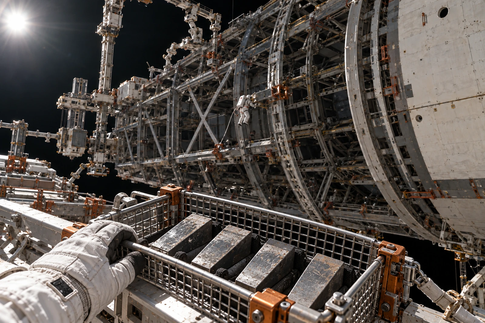

# 建木船台工装库 · 红边卡JM-J17

**不是舰体附件。不得随船移交。**

楔片四枚，来自B区旧定位架J17，卸载前已由独立约束装置接管工装受力。该动作不构成主承力龙骨重新验收，也不解除任何在船接头的复核责任。龙骨既有签认链另见GS-2140-01，本卡只管工具库收件。

### 脱载指示窗

值班员先拍负荷显示，再拍机械限位指针；两张必须同班。08:42指示回零，08:47完成锁定，08:53松开第一枚楔片。原排程把第二步写在第一步前，工长在终端退回，未依错误顺序操作。

取出的四枚楔片均入约束网框。没有“落到平台”一项。浮离一枚即触发清点停工，不允许先做下一步再补录像。

| 楔片 | 毫米，工作端厚度 | 状态 |
|---|---:|---|
| J17-A | 18.42 | 送检 |
| J17-B | 18.39 | 送检 |
| J17-C | 18.18 | 超出本工装重用下限18.30，隔离 |
| J17-D | 18.41 | 送检 |

四个厚度只说明本次测点，不据此推算剩余寿命。A、B、D的无损检验与配合面复查尚未完成，不能在表里写“可用”。C项用冲孔隔离牌穿过搬运孔，禁焊补增厚后沿用旧号。

### 返库重量

四枚总质量19.240千克，收存框7.600千克，合计26.840千克；测量采用惯性称量工位，显示保持质量单位。网框离台前由两套约束交替交接，不以人在旁边看守代替固定。

工具员在C的边缘发现一截旧纤维带，称量时仍在，已拍照后装袋，质量包含于19.240。待清理复称再拆账，当前不填四枚净金属质量。

### 收存申请驳回联

居民教育组申请借C作“飞船的一部分”触摸展品。库房只同意借用照片，实物暂扣；说明文字应写“总装工装楔片”，不能写“飞船龙骨”。这枚楔片未装入在船结构，也没有核准作为备用结构件。

翻到旧领用卡背面，可见三名不同工长的缩写。当前领用人只在新栏签名，没有把第四个名字填进旧空格。

库房备注：架还在外场。楔片已经回库。两件事分别销号。
