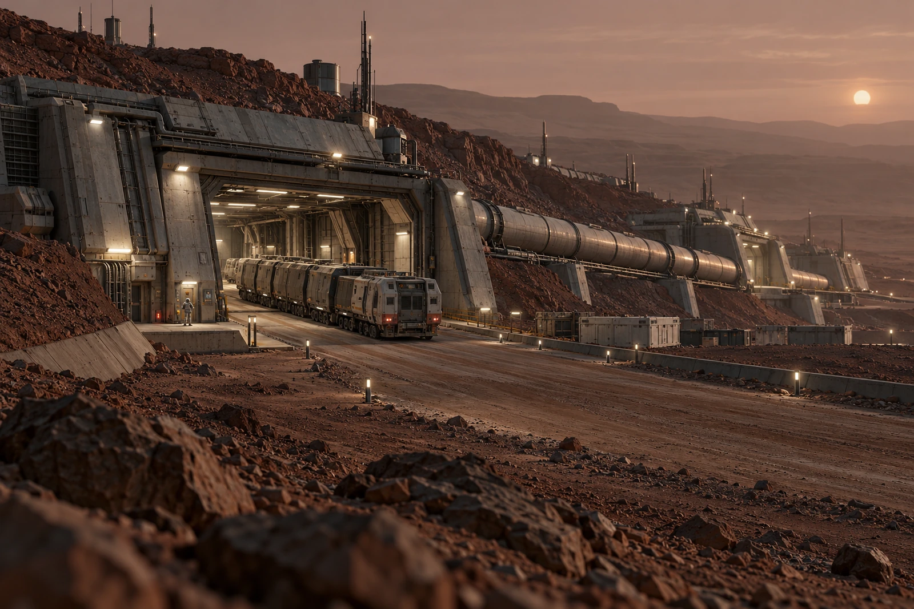

# 第四压力站 · 候车棚借用回执

车已改道，旧站牌还亮着。本回执先登记现场状态，再安排导向恢复，不为删去误导证据把维修前图像清空。

地表干线从掩体间经过，货运车辆封闭，压力站候车区与外侧坡道之间保有完整门与缓冲。管廊沿低脊铺开，远处地形仍有大片未开发部分。全景不把每座岩丘都点成居住灯窗，图上每个活动点应能找到本次工作的关系。

## 棚借给谁

原接驳任务改到邻站，候车棚暂借给本地轮换班休息，借用不等于改变站的长期用途。居民仍可凭原联系渠道查询新到达点，不能将旧站未上车者一概列为自行放弃。

| 借棚登记 | 人 |
|---|---:|
| 原申请 | 9 |
| 实际到场 | 7 |
| 取消 | 2 |

食物配送按实际领取记，七人中一人未领餐并不减少棚内人数。原单把餐份数复制成占棚人数，窗口退回重核。

一名搬运员替同伴收了被导向旧站的包，保管处核实授权后交付，未让他替本人签候车签到。物与人的去向分别留条，不用一张“已领走”证明两者一起离开。

旧站牌恢复完毕后先拍现状，再让导向岗核认；灯熄灭只是一个动作，不能证明所有持旧线路图的人都已知道。回执附原广播与更新稿，不将两次通知日期抹成同一时刻。

七人实际退棚后才交还钥匙。货车还在干线上走，本站当天的公共候车任务没有因此被写成重新发车。
