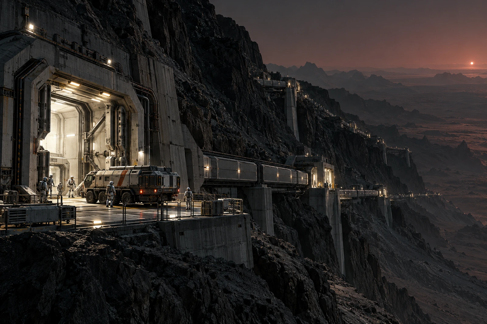

# 新海安第一岩脊 · 地表便道禁行单

跨脊捷径划掉，不擦。它曾出现在上一版路线图里，撤回通知须能让持旧图的人看出究竟改了哪一处。

压力廊门沿地形布置，短连接廊、外侧检修点与舱外便道是三种通行环境。住民从一处压力门看得见对面门，不等于中间全段可不穿装备步行。导向图按边界分别标线，严禁把一条好看的连续亮带当作连续可呼吸的走廊。

## 本次复核范围

门体识别、压力边界与允许使用状态由对应岗位签认，事务窗口只发布由此得到的通行安排。

- 本次开放：两门。
- 本次检修：一门。

未开放那扇门的旧门牌仍在，不把留牌解释为继续准行。

有四名申请人问能否提前走便道赶上下一班，均告知改由原等候处办理。未发生外出，不登记四次违反禁行。接驳改签按实际处理，等待人员的食物与休息安排不随路线关闭自动取消。

总览摄于岩脊检修点，近端固定架、密封车辆、双气闸与绵延岩体使路线可辨。画面不画裸露居民站在异星空气里，也不凭想象添一座透明穹顶让所有路径突然都变安全。

旧图收回七份，发新图六份，一位只要电子版。收回七不等于还有一人没通知：通知人员与纸张数量两份表核对。那条划掉的捷径在保管副本里完整可读，留给下一次改图的人先看。
