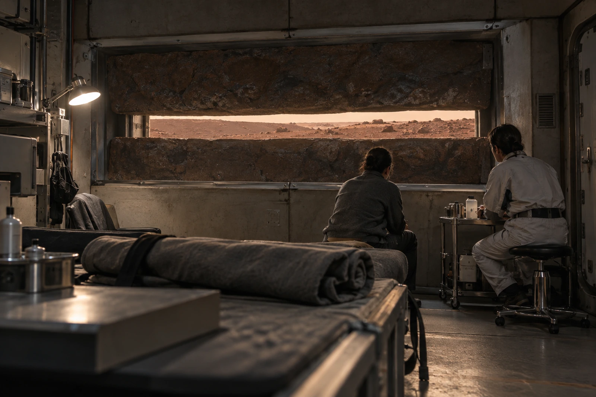

# 第一暂栖营地事务处 · 预约退回件

2356年十月十六日。编号适-56-109。申请栏“户外适应合格”退回，改填“室内模拟观察完成”。本周未安排申请人出舱，不能用开窗观看抵作户外暴露记录。

申请人林簌，船生，现任地下水管检修轮换员。此次仅为环境适应课程预约，不是执业体检，不在本卷诊断心理或前庭疾病。

### 观察窗的开度不归课程员管

适应室位于加压岩层工区，窄视窗外有折角遮蔽与可闭合防护板。当天耀斑警戒、剂量监测及舱外作业许可由营地原值班链决定。课程员只能在获准的状态下控制室内遮光布，不得自行开外防护板求“完整地平线”。

十月十五日试课，申请人在观察四十秒后要求遮住窗下缘，理由栏原话“地面一直往外去”。课程员照办，没有把手移开，没有要求其证明眩晕。退出按钮有效，记录未触发。

### 布卷领还

| 物件 | 发出 | 收回 | 状态 |
|---|---:|---:|---|
| 不透光布卷 | 1 | 1 | 下角一处旧补丁 |
| 固定夹 | 6 | 6 | 其中1枚弹簧偏紧，送检 |
| 边缘配重条 | 2 | 2 | 只用于室内布帘 |

布卷原长2.40米，补丁没有增加长度，领用簿仍填2.40。申请人想带走一小段作床边遮挡，未从公物上裁下，后勤另发一块库存余料0.30米。余料是独立领用，不写进归还少料。

### 错填栏逐项更正

“户外耐受六分钟”改为“室内总停留六分钟，其中窗景可见四十秒”。“独立行走合格”删除，本次没有步行考核。“拒绝地表生活”删除，申请人只要求遮窗下缘，没有提交迁居申请。

原填表人签认两次，第二次是在更正旁，第一次的名字不涂去。调度组收到的只是“课程未完成”，无需取得申请人的原话；岗位是否受影响另依实际作业资格，不由本课结论自动降级。

### 下次预约

允许申请相同观察条件，不要求逐次加时。课程时间暂定十月二十三日，能否进行须看当日环境与值班安排。适应室不能承诺天气，也不能承诺看见什么。

申请人在余料领用栏写：“不是要黑，只遮下面。”后勤照原句抄录，未改成“完全遮光需求”。
