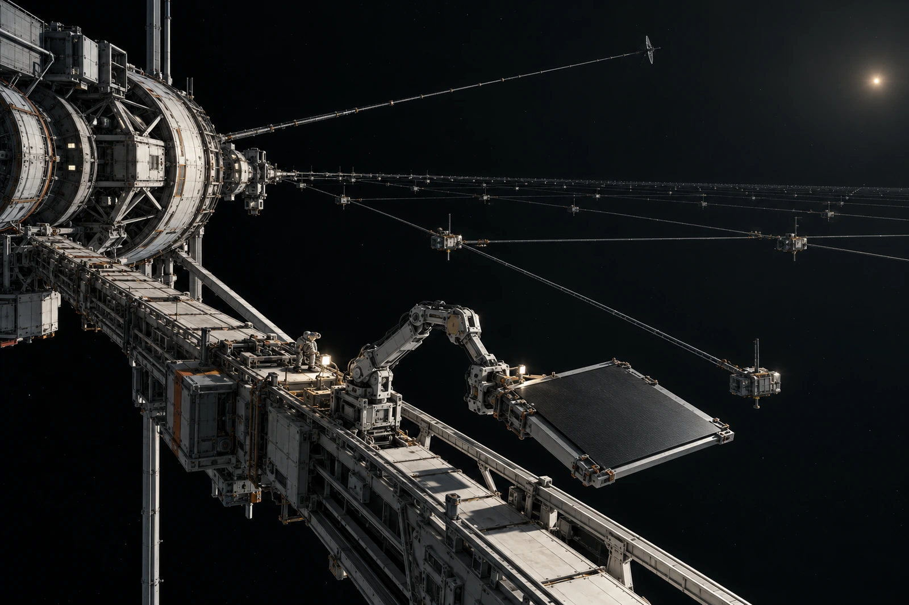

# 日球层外采样组 · 未见边界记录

边界栏写不可直接见，不写没有边界。所附广角图大部分为黑底，保留原曝光，不以彩色壳层替代本次缺乏的可见光形态。

采样网与仪器梁稀疏展开，近端空白基底由固定机构送入工作位置。大尺度留证靠框架、维护器与深空的关系，不靠一条发亮的天墙。环境参数由相应仪器记录，不能用“照片没有东西”推翻它们，也不能从仪器变化捏造肉眼景象。

## 基底更换登记

| 基底类别 | 片 |
|---|---:|
| 用于采样 | 2 |
| 作空白 | 1 |
| 未用 | 1 |
| 出库合计 | 4 |

回收记录按实物状态，不按名字里的“空白”去掉一片。未用片未暴露，不预填采样开始时刻。换出的旧片与其数据关联，图像副本不承担实物封存。

一次局部反光被自动识别为尘埃带，复核定位到检修臂关节。该帧标记反光来源，仍保留在原包；公众查阅页给出说明，不把关节擦掉只留下“看起来像发现”的亮斑。

工作灯照亮的是近端机构，远端网面有些段落没有成像。维护清点按遥测与获准复核完成范围，照片不可见段保留未识别说明；不为让总图闭合而描出每根线。

记录员在预置封面上划掉“穿越彩色边界”一行，那是旧展示标题，不是任务要求。新封面只列采样批号、工况与实际时间。巨大的空处没有消失，本组也不负责把它变得热闹。
