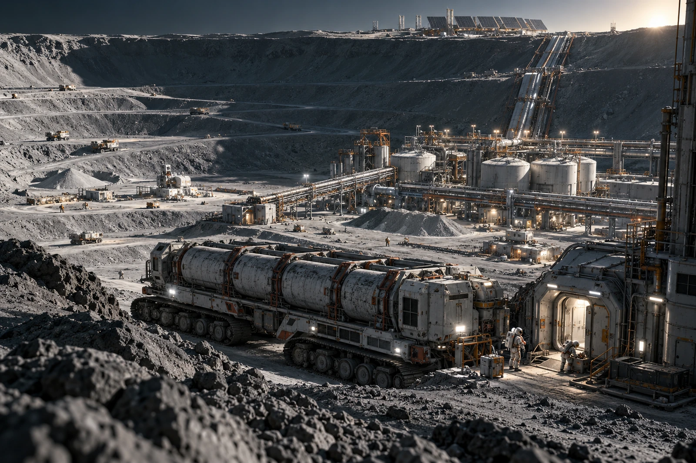

# 月极冰料处理坡道 · 第二班移交簿

水票留在窗口，灰尘封膜别撕。封膜下的划痕是在装料台形成的，出水结算时用它核对这一批，不拿封膜本身作含水量证明。

来料三车，均卸入各自隔离仓，未直接并入运行料。坡底采料区在长影里，供能与维护设施在远处亮脊上，中间依次是密封滚筒、冷凝处理和回流管廊。近端那条不进主仓的坡道是弃料暂存路，不得从总览照片中抹去；本班的不确定物正在那里。

一号仓取样送检，二号仓待复核，三号仓封存。仅一号具备后续处理条件，也不等于已得到可用水。货方申请先兑三张水票，窗口准登记三批来料，只允许按实际收水记录结算。

弃料堆新增覆盖袋两只。第一只袋外写“无水”，后经复核改为“本次工艺未回收”，旧字留存。这里没有做穷尽提取试验，不能替后来的处理班断言袋内永远没有水，也不能把未来可能回收的水算进今日产量。

## 交班清点

采样铲一把，封签四枚，洁净样袋六只；已用三只、作空白一只、未用两只，数量相符。驾驶员将车轮外侧留样的袋号写在水票背面，接班员要求移到污染监测栏，水票原背面不刮除。

入水端、净化端、贮水端读数各随原表存档，不以一张“水已找到”的照片代替。留守处借总览图作培训，图注只写工区与班次，不把远处小车旁两个人说成“发现者”。

第二班末签：水票在窗，车已回棚。二号仓还没有答复，第三只封签也没有拆。
