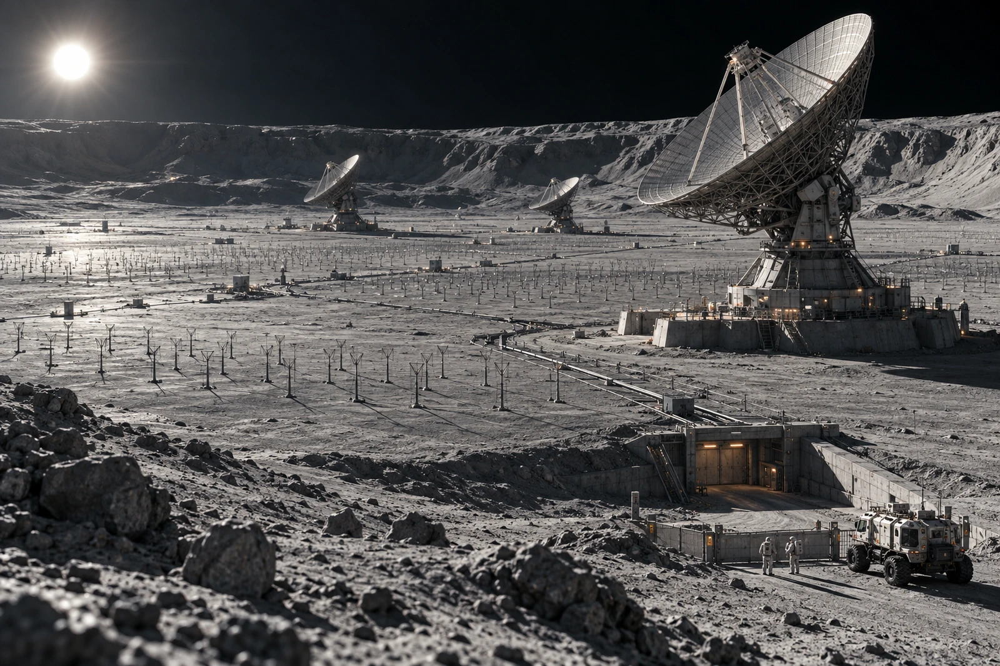

# 月背第六测线 · 封路记录

值班铃用手拨才响。电池已取出，装在接收机房的屏蔽盒中；这不是损坏件。封路岗换人时先试机械拨片，不为演示方便接通无线模块。

今日封路范围从近侧路桩至低频阵列外侧沟口。干涉阵在远坡铺开，近处看是一截截矮杆，越过山脊才看见收束到机房的线槽。货车司机说照片上“都没人”，申请抄近道；监测值班员只答复“正在观测”，没有把无人员等同于无工作。

进场预约五项：两项延后，一项改从外环，一项取消，一项为断电检修工具的步行交接。取消项保留原号，不拿来补新车。获准步行交接者穿舱外服，沿既有标志行进；安静区不等于可不检查生命支持。

## 三次交班拨铃

08:10，前班拨一次，后班复拨一次。08:12，工具袋交过门槛。08:14，内门关闭，封路牌仍在。接收端只登记本地传递完成，没有开机广播“大家都已知道”。外侧物流班由其原调度链另行通知。

工具袋中一部备用电台未卸电源。封路岗没有让携带者在阵列边缘开机证明它处于静默，而是连袋退回屏蔽间检查。取出电源后重新交接，迟延记在本次手续，不写入阵列故障时间。

全景留证中有三处光斑，经查为反光罩，不是新设备启用。摄影员关闭后期星点增强，原始黑底保留。没有被拍亮的矮杆仍在设备清册里，不从图像可见数量倒推库存。

封路岗末签：铃在，路封着。下一次拨铃人须在本页背面签收，不能让远处镜头里的手势代签。
