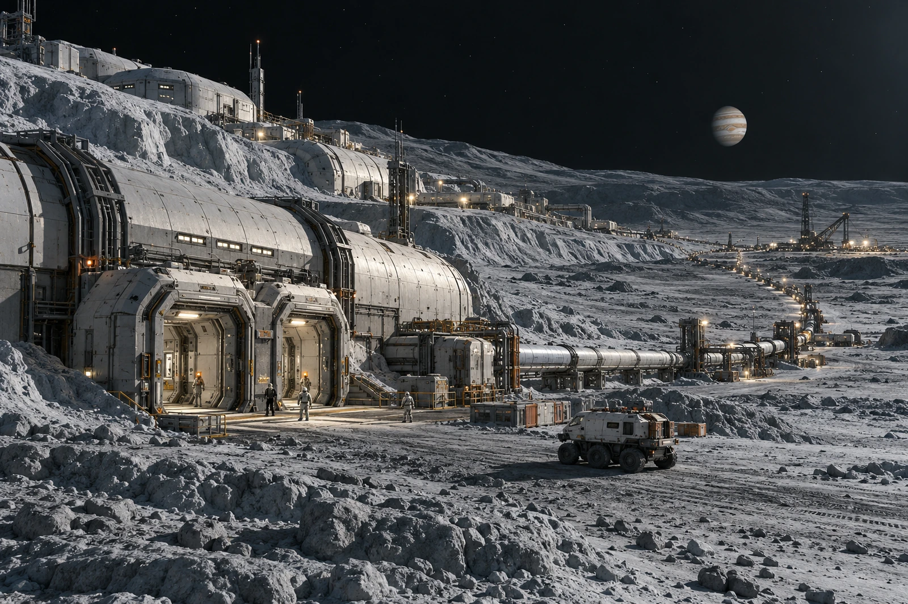

# 木卫四外门 · 换班候车名册

样袋上的“雪”字保留，又在后面添“外门冰尘”。本次未见大气降雪，不将舱门边采得的微粒写成气象观测。

半埋压力设施沿旧坑地形展开，外门、物料工区、绝热管路与等待车辆各在自己的路线上。总览留住近端双气闸、密封车辆和远处低矮设施，木星只作远景位置参照，不把它放大成贴住屋顶的墙。

## 三袋与两个人

门框擦拭样两袋，空白一袋；采样员两人按各自实际操作签名，不因第三只袋便补第三个人。外表留样按环境检查收录，人员健康记录另走医疗岗位，不直接将同班工号挂成感染样本。

候车十二人，车辆本次接收八人，其余四人仍在压力区等待。外门复核未完，不能把四人提前放在舱外排队，只为车辆到来后节省门口时间。候车名册与出舱许可分别办理。

一只样袋被贴在名册背面，编号透印在一名人员姓名上，扫描程序错读为样本对象。原扫描留差错记录，重新分开封装。没有为了删去错误提醒而顺手删掉采样事实。

照片中一处白亮边为入射光在霜面反射，检验组不以亮色证明新冰层厚度。材料参数须由相应测量给出；本册只记何处、何时、由谁取了样。

八人已乘车，四人未离开原等候区。门边样袋送到本地检验台，车并未带走。交班人在两份回执上各签一次，第二个名字与第一个一样，也不能省略。
