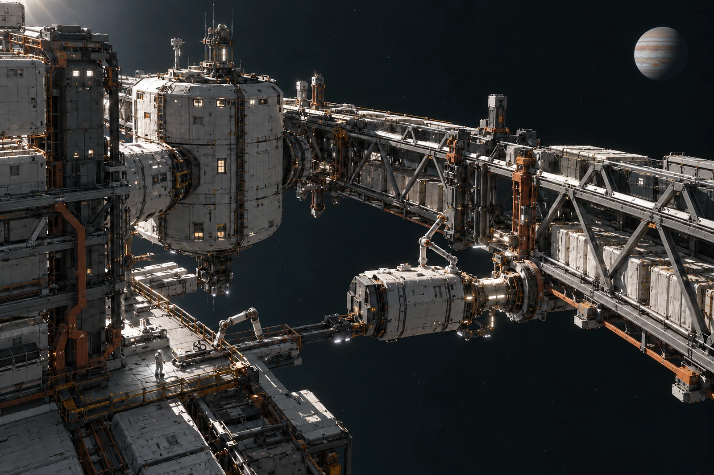

# 木星高轨转运架 · 延后上工回条

轮值时长与累计剂量分开计数。回条上两栏的单位不同，不相互抄数，不以人员出勤完整推定累计暴露符合工作要求。

本班延后的是人员进入维护点的时段，无人设备继续执行既定受控任务。转运架与小型屏蔽工作舱分开，在远处木星前形成稀疏剪影。外场画面不得添一圈可见辐射彩带，风险由测量与岗位许可表达，不靠天空颜色判断。

## 原班表的保留

六人原定入场，四人按新时段进入，两人调至压力工作舱内任务。不是两人被取消工时，更不是以一张通用健康合格表互换任何岗位。个人记录按必要权限保存，公开班表只列岗位与时间。

有人要求把本次延后改写成设备故障，理由是统计好归类。设备本班未报告故障，回条保留真实调度原因。保障预算也不以“机器都没停”为由取消人员等待期间的安排。

近端检修器沿捕获轨工作，服务舱、气闸、稀疏货架与远处行星各有可读大小。镜头若使木星填满全部背景，维护架的位置将被误读为贴近掠过；摄影组保留原机位说明，不用不相称的行星替工位增添压迫。

本地值班员签的是已收到延后安排，防护岗位的确认另在原单。回条尾部留有两名改岗人员的实际工作去向，没有只写一个“缺勤”。班次结束时四人退出，两人内侧任务仍按自己的交接进行。
