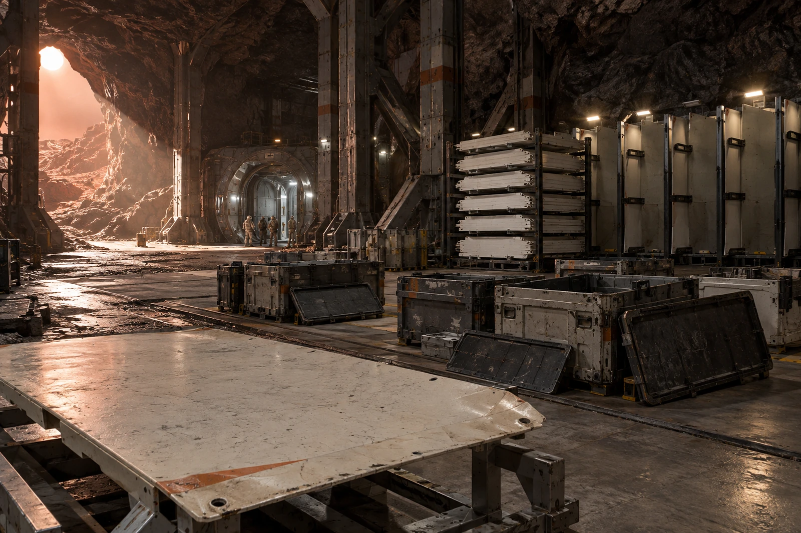

# 比邻星b地下仓务所 · 第57号接收清册

公元2357年3月21日，登陆历7年。接收地点：首期地下仓外侧设备廊。发运地点：ARK-01轨道维护库。

## 箱盖压出的矩形

空箱外框四角擦亮，中间仍是旧涂层。第一块护板出箱时留下0.8毫米厚的边角垫片，搬运班拟随空箱返运；检验员止住，垫片是本次缓冲物，不是箱体。拆下后与废包装分别称量。

护板来自轨道退役设备外覆层，只用于无压地下仓设备隔热与防碰撞护罩。仓的气密边界另有独立承压结构。本清册不授予旧板压力容器资格，不将外覆层读成辐射剂量保证。

## 到件数与准用数

| 项 | 块 | 状态 |
|---|---:|---|
| 到货 | 24 | 箱内点验 |
| 检查通过 | 18 | 准入无压护罩工位 |
| 边孔变形 | 4 | 隔离待修 |
| 裂口 | 2 | 禁止安装，待回收 |

二十四块不等于二十四块都能用。新开仓墙上有二十四个挂位，安装组只占十八个，六个位留空，不用颜色相近的新板顶数。旧板背面号牌另拍，照片不替代受力计算。

## 一份旧档案没有下地

随货数据包附有建木船台K-46接口卡副本，档案号GS-2146-01。参考用途为签认范围培训：检测员签实测、装配员签未加载，不把一人签名扩大成全项放行。副本不是本批护板的制造履历；副本中的错孔支座也不在本箱。

收件员曾在备注栏写“二百年前原件”，已划去。二百年前的是文书，本箱旧板制造日期按各自号牌登记，不能借一个旧档号给全部材料加年岁。

## 返箱清单

空箱六只，箱内隔板十二件，留存的入库缓冲垫片二十四片。返轨道空箱质量186.0千克，其中隔板质量24.0千克已含，不另加。垫片共3.6千克，留在地表包装回收间，不算返箱质量。旧板总质量另见入库称量联，不混进本段。

返运排进下一次许可窗口。箱已去盖晾检，未封口，不得写“已发”。运费预算只是申请，不能凭预算数认定货已经返轨道。

## 收件签

仓务员魏芮签数量，材料员穆林签适用范围，搬运班签箱体完好。安装位置栏由安装班另签，现空白。

**墙面附条**：六个空位照旧留着。门口的账，先算到门口。
