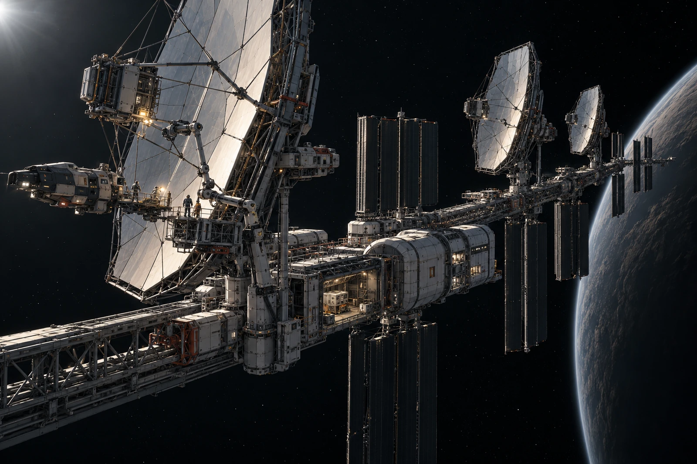

# 外轨接收阵 · 维护空窗排班

同一张卡保留两套时间。左栏为来源设备原时标，右栏为本站换算，不以纸面整齐为由只留一个。

接收阵由光学组件、维护主干、独立热排与数据保管单元组成，当前维护窗口只占其中一个工作点。外场总览须看出三种功能区的联系，不让所有设备都变成同一朵发光天线。远端来信的传播下限不因本站换算时标而缩短。

**本地今天**

设备岗确认维护起止，业务岗按实际受影响任务列延期，档案岗保留原数据。三者不是按三种时钟重复收三次维护费，计费项回到实际工作，发生一次只计相应一次。

排班表初稿把来源日期转换为本地后，又在导出时转换一次，导致一项任务落在错误班次。原始字段仍在，复核员依来源与本站记录逐条核对，未靠记忆把那一项挪回“看着合理”的地方。

窗口外一只密封服务载具停在获准捕获位，旁边小型机器人沿机构工作。相机拍不到任何横跨恒星系的亮线，展示图不补。通道是否运行由原记录支持，画面只是目前能看见的设备状态。

值班员把自己熟悉的民间班名写在页脚，公共排程仍用能复核的时标；两者并存，未以此成立第三套设备时钟。下一班读卡时先认来源，再认换算，最后才找到那行“暗灯前”。

维护空窗已安排，实际恢复时刻待现场完成后记录。卡片两栏都留着，不能由一栏预测另一栏将来收到什么。
