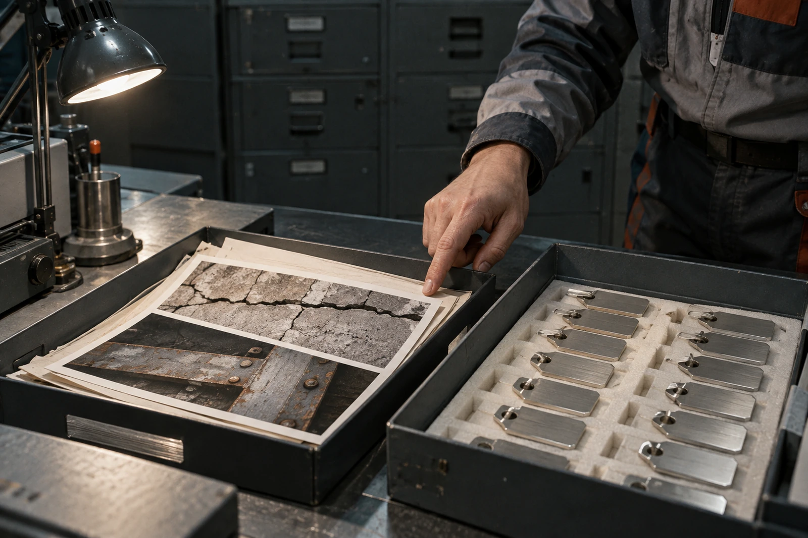

# 接收站离线整理台 · 空栏不得补齐

2692年十月十六日，处理批P-2692-71。涉及GS-2684-01所记维修档案副本与后续询问，不更改原收讫簿。

目录软件升级后，原“原物现存状况：待问”字段被迁入必填栏。系统给出的建议值为“保存完好”。该值来自最近一次副本校验通过，不是验物回报。升级验收暂停一项，其余检索可继续。

## 两个托盘

左盘是静海CW-17见证砖与第六维修坞梁端牌的照片副本。右盘是本站新制作的封签，未经过星际运输。新封签只封本站载体盒。照片中的物件与盘中的金属片不能共用“现存实物”字段。

整理员戴手套把右盘推近，图像识别器自动建议“古代构件”。已拒绝。识别结果留在试验日志，不进入公开目录。

## 日期核算卡

2684年十月二日，本站登记“原砖是否仍在”请求。即使当日立即发出，对端立即处理，在4.24光年的单程光时下，答复往返也不得早于约2693年春。窗口排队与办理时间另加，不从光时中扣。

今日2692年十月十六日，本站未收到答复。旧簿所列最早返回年2693仍成立，不能用今年的整理日期把请求改成今年才发，也不能把等待年数写成物件失踪年数。

| 字段 | 可填写内容 | 本次值 |
|---|---|---|
| 副本字节校验 | 本站实测结果 | 一致 |
| 原物现状 | 对端带日期验物答复 | 待问 |
| 本地封签状态 | 本站目视及领用记录 | 新制，未封装 |
| 回答接收时间 | 实际接收日志 | 空 |

校验一致不证明原物仍存在，也不证明旧称量单正确。CW-17旧主样4.342千克、碎片0.018千克原字段保留，不再替显示页重算精度。

## 保留空白的迁移补丁

必填规则改为允许“未获答复”状态；日期栏仍须真正为空，不能填零年、本站开站日或软件升级日。演示页面曾显示“0000-00-00”，截图保留作缺陷证据，正式检索不显示该串。

值班工程师只批准本字段迁移，不批准用本次变更重排旧簿签名。2684年的离岗人员名字仍在，不由今日经办人替换。

打印机在“回答”栏下方多走了一行纸。整理员准备裁去，复核员要求保留页长，避免把空栏裁没。右盘封签已领用两枚；左盘仍只有副本。

**待下一窗口核对。**
