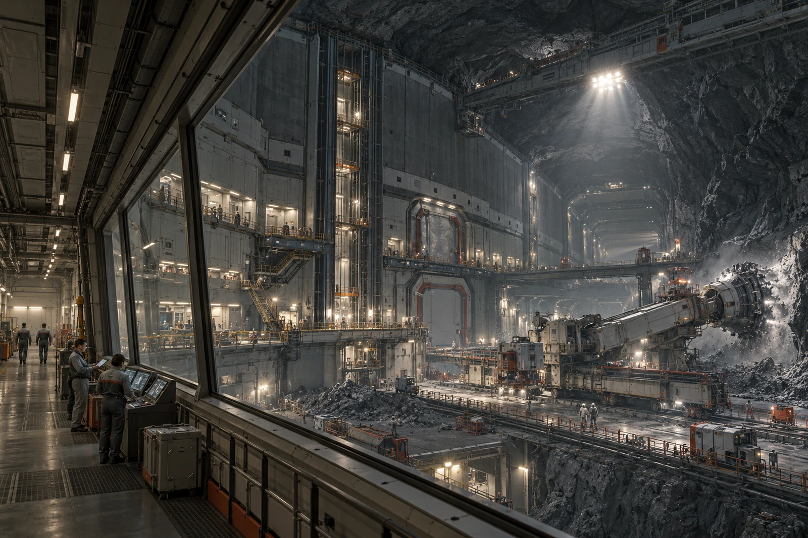

# 矿脊地下工区 · 远端井回声测试单

听见回声，不等于获准进入。远端井牌仍盖封闭标记，测试组没有接到解除隔离的权限。

本次在已核认的工作位置进行声学与设备联络检查，所附图像说明空间和边界，不用一幅深洞照片证明井下所有气密、支护与通道都已合格。压力工作廊、设备井与远端开采面在总图中分开，普通工作服人员仅在加压范围内。

**原音与标记**

测试发声三次，记录三段。第二段叠有设备声，原始音频保留，处理副本注明参数；不能把背景削净后声称井内当时只有那一下回声。声源与话筒位置按现场记录，不为便于拼图移动到另一层。

一位接班人把“有响应”写成“通道畅通”。复核划去后重写“本次测试取得响应”，未让他在整张通道合格表上补签。来班路线仍止于封闭点，未因听到远处声音多开放一扇门。

总览从内侧工作廊看向高井与岩体，近处人员门、中层维护平台与远端大型井构共同提供深度。工作灯按实际区域点亮，未用满洞熔岩或发光矿石制造深空感。岩层安静的暗面也留着，不将每处都铺成管线。

测试结束后，借出的传声器两只全还，一只保护罩送清洁。器材未装回原箱之前，器材员不签整箱复位。远端井仍封，回声测试单装入等待下一工序的袋里，纸上没有多出一次进入记录。
