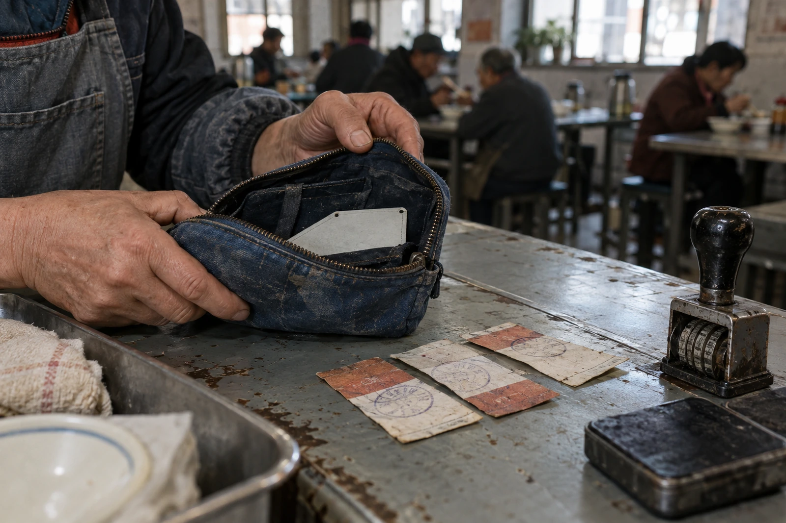

# 七里铺互助金 · 收款窗口留底

票号018。退票三张，未兑付。袋口两道缝，右侧浅布为本次补入，不计作捐赠物。

原申请人钱素萍，原岗为仓配录单，转训班报到日十月九日。互助金按七日工资空档预支，到账前由值班窗口垫付。十月十五日原单位结清九月尾款，系统将该笔列为“现有收入”，据此生成三张追缴票。申请人带来的尾款通知单背面贴着孩子的午餐回执，扫描时一并入了库。

**复核栏：尾款所属劳动期间为九月，不与十月转训空档重叠。追缴撤回。**

## 票根与现金不在同一栏

| 项目 | 元 | 本次动作 |
|---|---:|---|
| 月初互助金可用余额 | 18,420 | 原账保留 |
| 本月已付空档补助 | 3,360 | 其中钱素萍420 |
| 已收自愿返还 | 700 | 不含本案退票 |
| 期末可用余额 | 15,760 | 18,420−3,360+700 |

撤销票面合计420元，仅撤销应收，不增加现金。上一版结算把“追缴取消”当作“收到返还”，余额多出了420元；旧表斜划作废，订在本表后，不抽页。

申请人另交蓝布工具袋一只，请折抵补助。窗口拒绝作价。袋中有弯针两枚、线轴一个、断拉链一条，均非互助金抵押物。本人说转训课要带自己的维修小件，袋口已裂，愿先放在这里等志愿缝补员。

## 缝补员的领件条

十月十六日11:20领袋；11:46归还。用了浅灰布一块、线约两米。没有蓝布。补片未染色，以免把新修补记成旧损伤。针数不折算培训出勤，二十六分钟只进志愿值班簿。

钱素萍在收件栏写“钱”，笔停了一下，往下续完名字。签字压着那道新缝，字迹没有扫平。她要求把退票也拿走，窗口给了副本，正联须留。

复核员附签：在本窗口办过的救助，不作为转岗考核分数。转训班若需出勤证明，另取签到记录；本联只能证明三张票已撤销、一只袋已归还。

**关窗清点**：现金无差，票根三张，代管物零件。扫描附件中的午餐回执撤出公共检索，原件仍归本人。
