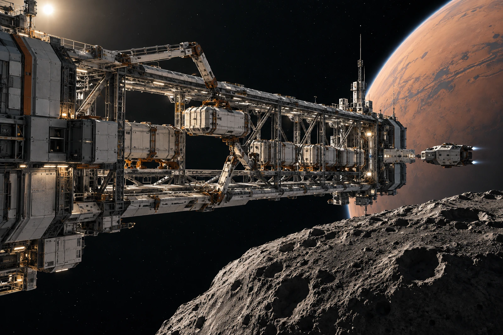

# 火卫一近旁自由装卸架 · 轨道更正单

货单的地面坐标栏填不适用。这里没有在火卫一表面卸货，照片里靠得很近的坑壁也不在装卸架脚下。

装卸架为自由飞行设施，本次接近与捕获状态由当地调度复核，未以长缆系在小天体上。制图时那条虚线仅是说明关联，曾被自动渲染成实物拉索，展示件退回。不得用一条不存在的缆把轨道问题变成地面锚泊问题。

全景从近端桁架向外拍，货筒、机械臂、检修接口和远处火卫一依次缩小，黑色空隙须保持可辨。更远处的火星弧面不与小天体接成一块地形。小艇封闭，凭姿控与获准程序接近，不在架边找车轮落地。

## 货到哪里了

四只货筒到架，三只完成本次接收，一只留在原承运约束中等待。账房不得按画面上“四只都在附近”确认四件交付。尚未移交的一只仍按原责任方保管，不以机械臂已伸出来便转移风险。

原单把接近修正写作地面车辆“绕行”，现改为当次轨道与操作状态修正。改词不改变原遥测，实际机动量由原记录负责，本组不从图片绘制新的速度与推力。

一枚纸质吊签在压力工作间找到，未随货进入外场。搬运员在影像里没看见吊签，以为货筒身份不明；核对后确认使用的是外场适用标记，纸签只供内侧台账。不要求为让图片看起来像提单而把纸条挂到真空里。

收件员末签三只，第四栏空。脚下没有地面，表上也不再有伪造的地面坐标。
